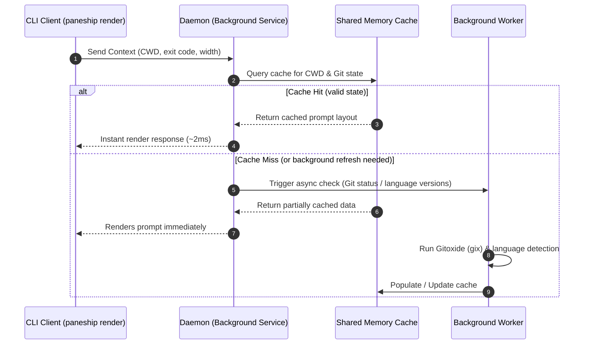

<div align="center">


# Paneship

**A blazingly fast, high-performance shell prompt optimized for tmux and large Git repositories.**

[](https://crates.io/crates/paneship)
[](https://docs.rs/paneship)
[](https://github.com/andev0x/paneship/actions)
[](./LICENSE)
[](https://github.com/andev0x/paneship/stargazers)

---

[Key Features](#-features) • [Demo](#-demo) • [Installation](#-installation) • [Shell Setup](#-shell-setup) • [Configuration](#%EF%B8%8F-configuration) • [Architecture](#-architecture) • [Benchmarks](#-benchmarks) • [CLI Commands](#-cli-commands) • [Troubleshooting](#-troubleshooting) • [Contributing](#-contributing)

</div>

---

##  About

**Paneship** is a modern, ultra-fast, and customizable command-line prompt utility written in Rust. It is engineered from the ground up for developers who work in terminal multiplexers (like tmux), manage large Git repositories, and demand a snappy shell interface. 

By leveraging a persistent background daemon, asynchronous Git checks, and smart cache invalidation, Paneship achieves a rendering speed of **~2.5ms**, keeping your shell highly responsive even in massive monorepos.

---

##  Features

-  **Sub-millisecond Performance** – Renders in **~2.5ms** on average by using a client-daemon architecture.
-  **Non-Blocking Async Detection** – Git status checks and language/runtime detection run in background workers. Metadata never blocks the render path; a `[lang...]` placeholder fills in until the worker reports back.
-  **Modular Detector Registry** – Every language lives behind a single `Detector` trait in its own file, reading version pins directly from `Cargo.toml`, `package.json`, `go.mod`, `pyproject.toml`, … with no external subprocess.
-  **Interactive Configurator** – `paneship config` opens a TUI with a live prompt preview, atomic saves, and instant daemon hot-reload.
-  **Icon Sets & Themes** – Built-in `nerdfont`, `emoji` and `minimal` (ASCII) profiles plus colour themes, so prompt formatting adapts to any terminal or font.
-  **Multi-Shell Compatibility** – Native integration scripts for Zsh, Bash, Fish, PowerShell, Nushell, Elvish, Xonsh, Tcsh, Ion, and Cmd.
-  **Tmux-Aware & Responsive** – Automatically detects tmux pane width changes and truncates long paths or metadata gracefully.
-  **Git Integration** – Visual branch status, staged, unstaged, and untracked counts computed efficiently.
-  **Configurable & Aesthetic** – Easy-to-use TOML-based configurations. Fully supports custom icons, emojis, and Nerd Fonts.
-  **Rust/Node/Bun/Go/Python/Deno/Ruby/PHP/Java Version Detectors** – Automatically fetches and displays active development environment versions in your metadata area.
-  **Native Right Prompt (RPROMPT)** – Zsh (`RPROMPT`/`RPS1`), Fish (`fish_right_prompt`) and Nushell (`PROMPT_COMMAND_RIGHT`) bind the width-aware right region natively; low-priority elements (timing, clock) collapse first so narrow tmux panes never wrap.
-  **Infrastructure Detectors** – Kubernetes context/namespace, container markers, AWS/GCP/Azure profiles, and Nix/Direnv state, resolved in background workers with a hard 10 ms per-detector budget.
-  **Live Telemetry** – `paneship top` streams daemon worker utilization, cache hit ratios and average lookup latency, LRU evictions, and filesystem-watcher throughput.
-  **Command Execution Timing** – Keeps track of long-running command durations and presents them in a human-readable format (e.g., `11ms`, `1m20s`).

---

##  Demo

<div align="center">
  
</div>

---

##  Installation

### One-line installer (Recommended)

Downloads a prebuilt binary for your platform and falls back to building from
source when necessary:

```bash
curl -fsSL https://raw.githubusercontent.com/andev0x/paneship/main/install.sh | bash
```

Pass `--version <tag>`, `--dir <path>`, or `--from-source` to control the
install:

```bash
./install.sh --from-source --dir "$HOME/.local/bin"
```

### Using Cargo

Installs the package directly from [crates.io](https://crates.io/crates/paneship):

```bash
cargo install paneship
```

### From Source

Ensure you have Rust and Cargo installed (Rust 1.70+ is required):

```bash
git clone https://github.com/andev0x/paneship.git
cd paneship
cargo install --path .
```

Verify the installation:

```bash
paneship --version
```

---

##  Shell Setup

Paneship can configure itself automatically or be integrated manually.

### 1. Automatic Onboarding (Recommended)

Run the `init` command with the `--onboarding` flag. This will automatically detect your shell configuration file and append the necessary initialization block safely. It also handles starting the background daemon for you.

```bash
paneship init <shell> --onboarding
```

*Example for Zsh:*
```bash
paneship init zsh --onboarding
```

`paneship init <shell> to onboarding` is an accepted alias for the same
behaviour. Onboarding is supported for Zsh, Bash, Fish, PowerShell, Nushell,
Elvish, Xonsh, Tcsh and Ion.

### 2. Manual Configuration

Add the corresponding snippet to your shell configuration file. Note that manual configuration requires you to ensure the `paneship daemon` is running for optimal performance.

<details>
<summary><b>Zsh (<code>~/.zshrc</code>)</b></summary>

```bash
eval "$(paneship init zsh)"
```
</details>

<details>
<summary><b>Bash (<code>~/.bashrc</code>)</b></summary>

```bash
eval "$(paneship init bash)"
```
</details>

<details>
<summary><b>Fish (<code>~/.config/fish/config.fish</code>)</b></summary>

```fish
paneship init fish | source
```
</details>

<details>
<summary><b>PowerShell (<code>$PROFILE</code>)</b></summary>

```powershell
Invoke-Expression (&paneship init powershell)
```
</details>

<details>
<summary><b>Nushell (<code>config.nu</code>)</b></summary>

```nushell
mkdir ~/.cache/paneship
paneship init nushell | save --force ~/.cache/paneship/init.nu
source ~/.cache/paneship/init.nu
```
</details>

<details>
<summary><b>Other Shells</b></summary>

For other supported shells (Elvish, Xonsh, Tcsh, Ion, Cmd), evaluate or source the output of:
```bash
paneship init <shell>
```
</details>

---

##  Configuration

Paneship configuration is defined in `~/.config/paneship/config.toml`. Sensible defaults are applied if this file is not present. Run **`paneship config`** for an interactive TUI with a live prompt preview.

### Default Config Structure

Prompt glyphs and colours resolve from an **icon profile** and **theme**, so you rarely set icons by hand:

```toml
[icons]
profile = "nerdfont"   # nerdfont | emoji | minimal

[theme]
name = "default"       # default | dracula | nord | tokyo-night | gruvbox

[prompt]
rprompt = true         # render the right-aligned metadata region
rprompt_min_width = 20 # below this width the right region is dropped

[environment]
enabled = true         # master switch for the environment segment
kubernetes = true      # ~/.kube/config context + namespace
docker = true          # /.dockerenv, /proc/1/cgroup, $container
cloud = true           # active AWS / GCP / Azure profile
nix_direnv = true      # IN_NIX_SHELL and .envrc state
health = false         # opt-in CPU load pressure / low battery

[directory]
icon = ""              # empty = active icon profile
truncation_length = 3
truncate_to_repo = true

[git]
branch_icon = ""       # empty = active icon profile
staged_icon = "+"
unstaged_icon = "!"
untracked_icon = "?"

[status]
success_icon = ""      # empty = active icon profile
failure_icon = ""

[metadata]
time_color = ""        # empty = active theme
paneship_color = ""    # empty = active theme
```

> **Note**: An emoji-based configuration is available in the [example_config.toml](./example_config.toml) file. Switching `profile = "emoji"` or `"minimal"` updates every segment at once.

### Configuration Reference

#### `[icons]`
| Parameter | Type | Default | Description |
|-----------|------|---------|-------------|
| `profile` | String | `"nerdfont"` | Glyph profile: `nerdfont`, `emoji`, or `minimal` (pure ASCII). |

#### `[theme]`
| Parameter | Type | Default | Description |
|-----------|------|---------|-------------|
| `name` | String | `"default"` | Colour theme: `default`, `dracula`, `nord`, `tokyo-night`, or `gruvbox`. |

#### `[prompt]`
| Parameter | Type | Default | Description |
|-----------|------|---------|-------------|
| `rprompt` | Boolean | `true` | Render the right-aligned metadata region at all. |
| `rprompt_min_width` | Integer | `20` | Minimum terminal width (columns) required to render the RPROMPT. Below this the right region is dropped entirely rather than risking a wrap. |

#### `[environment]`
| Parameter | Type | Default | Description |
|-----------|------|---------|-------------|
| `enabled` | Boolean | `true` | Master switch for the environment segment. |
| `kubernetes` | Boolean | `true` | Kubernetes context / namespace detection (`~/.kube/config` or `$KUBECONFIG`). |
| `docker` | Boolean | `true` | Container detection (`.dockerenv`, `/proc/1/cgroup`, `$container`). |
| `cloud` | Boolean | `true` | Active AWS / GCP / Azure profile detection. |
| `nix_direnv` | Boolean | `true` | Nix shell (`IN_NIX_SHELL`) and direnv (`.envrc`) detection. |
| `health` | Boolean | `false` | Opt-in system health checks (CPU load pressure / low battery). macOS shells out to `pmset` and runs under a looser 250 ms budget. |

#### `[directory]`
| Parameter | Type | Default | Description |
|-----------|------|---------|-------------|
| `icon` | String | `""` | Icon prefix before the path. Empty falls back to the active icon profile. |
| `truncation_length` | Integer | `3` | Maximum folder depth to display before truncating. |
| `truncate_to_repo` | Boolean | `true` | If true, automatically hides paths outside the Git repository root when inside a repo. |

#### `[git]`
| Parameter | Type | Default | Description |
|-----------|------|---------|-------------|
| `branch_icon` | String | `""` | Prefix icon for Git branch. Empty falls back to the icon profile. |
| `staged_icon` | String | `"+"` | Symbol representing staged changes. |
| `unstaged_icon` | String | `"!"` | Symbol representing unstaged changes. |
| `untracked_icon` | String | `"?"` | Symbol representing untracked files. |

#### `[status]`
| Parameter | Type | Default | Description |
|-----------|------|---------|-------------|
| `success_icon` | String | `""` | Prompt cursor character on command success. Empty falls back to the icon profile. |
| `failure_icon` | String | `""` | Prompt cursor character on command failure. Empty falls back to the icon profile. |

#### `[metadata]`
| Parameter | Type | Default | Description |
|-----------|------|---------|-------------|
| `time_color` | String | `""` | ANSI SGR colour code for the current time. Empty falls back to the theme. |
| `paneship_color` | String | `""` | ANSI SGR colour code for the package version. Empty falls back to the theme. |
| `languages` | Table | `{}` | Optional per-language `icon`/`color` overrides; empty fields fall back to the icon profile and theme. |

---

##  Color Coding Reference

Paneship uses standard ANSI SGR escape sequence parameter codes for styling. You can configure styles using single values or semicolon-separated options:

- `1` (Bold), `2` (Dim/Faint), `4` (Underline)
- `30`–`37` (Standard foreground colors: Red=31, Green=32, Yellow=33, Blue=34, Magenta=35, Cyan=36, White=37)
- `1;33` (Bold Yellow)
- `1;38;5;208` (256-color orange foreground)

---

##  Architecture

To prevent shell input lag, Paneship implements a lightweight **Client-Daemon-Worker** system architecture:



### Smart Invalidation
The background daemon listens on a platform-native local socket (Unix domain socket on macOS/Linux/WSL2, named pipe on Windows). It watches each active repository's Git metadata — `.git/HEAD`, `.git/index`, `.git/packed-refs` and `.git/refs/` (heads, remotes and tags) — and coalesces bursts of events (for example during `git rebase` or `git checkout`) with a short debounce window before invalidating the affected cache entries.

Shell hooks also emit an explicit `INVALIDATE_CWD(path)` signal right after any command that starts with `git `, so operations like `git push` or `git fetch` (which update remote-tracking refs) are reflected on the very next prompt without waiting for a filesystem event.

### Cache & Fallback Guarantees
Git state is held in an in-memory LRU store (default capacity: 500 working directories) with a hard 5-second TTL. When an entry expires, the daemon serves the last known value immediately while a background worker refreshes it (`stale = true`). If a repository is known but its state cannot be computed within the render budget (for example on a very large monorepo), Paneship renders an explicit `[git...]` placeholder instead of silently dropping the segment, and logs the failure to `~/.cache/paneship/daemon.log`.

> Tune the cache with `PANESHIP_CACHE_CAPACITY`. Git TTL is set with `PANESHIP_GIT_TTL_MS`; the metadata caches are tuned per category with `PANESHIP_LANG_TTL_MS`, `PANESHIP_PACKAGE_TTL_MS` and `PANESHIP_ENV_TTL_MS`, so a slow-changing signal such as a package version can be cached far longer than fast-moving Git state.

### Non-Blocking Metadata Detection
Language/runtime metadata follows the same stale-while-revalidate pattern. A cache miss or TTL expiry returns an explicit `[lang...]` placeholder immediately and dispatches a manifest parse to the worker pool — version extraction never runs on the render path. Parsing is **manifest-first** (via lightweight TOML/JSON readers) and spawns no external subprocesses (`node -v`, `python --version`, …).

Detectors are isolated behind a uniform trait: adding a language means implementing `Detector` in a single file and appending it to the registry in `src/detectors/mod.rs`, leaving the renderer untouched.

---

##  Benchmarks

*Measured on an Apple Silicon (M-series) host with a target budget of 4 tmux panes; run `paneship benchmark` to reproduce.*

| Stage | Average | Notes |
|-------|---------|-------|
| **Paneship render (in-process, 4 panes)** | **~0.35ms** | `paneship benchmark` — 344µs avg, components sum to ~150µs |
| **Daemon IPC + render round trip** | **< 1ms** | daemon-mode delta over a bare process spawn |
| Process startup (shell `exec`) | ~8ms | fixed OS cost paid by every prompt engine |
| Paneship (cold start, no daemon) | ~35.0ms | bounded first-render Git compute |
| Starship Prompt | ~20.0ms | |
| Oh My Zsh (default setup) | ~150.0ms+ | noticeable lag |

The render path is well inside the **2.5ms** budget: the expensive work (Git
`gix` status, manifest parsing, infrastructure probes) runs in background
workers, and the daemon serves cached regions over a local socket.

> The `benchmark` harness pins a fixed width. Passing no width would make
> `PromptContext` probe the terminal/`tmux`, so the timer would measure a
> subprocess spawn instead of the render path.

---

##  CLI Commands

### General
- `paneship --version`: Print the installed version and exit.
- `paneship help`: Print usage and exit.

### Prompt Rendering
- `paneship render`: Renders the prompt based on default parameters.
- `paneship render --shell zsh`: Format ANSI sequences specifically for Zsh.
- `paneship render --exit-code 1`: Renders the prompt demonstrating a command failure.
- `paneship render --cwd /path/to/dir`: Mock prompt rendering for a specific directory.
- `paneship render --width 100`: Specify custom width constraints.
- `paneship render --duration-ms 500`: Renders the prompt with a command execution duration.
- `paneship render --layout split`: Emit the structured `left \u001f right \n cursor` regions used to bind native right prompts (`rprompt` is an accepted alias).

### Configuration
- `paneship config`: Opens the interactive TUI configurator with a live prompt preview. `Ctrl+S` saves atomically and hot-reloads the daemon.

### Daemon Administration
- `paneship daemon`: Spawns the background socket server daemon.
- `paneship daemon ping`: Verifies that the daemon is active and responding.
- `paneship daemon reload`: Asks the running daemon to re-read `config.toml` (used by the TUI after saving).
- `paneship invalidate [--cwd <path>]`: Signals the daemon that Git metadata under `<path>` changed (used by the shell hooks).

### Performance Testing & Monitoring
- `paneship benchmark`: Runs multiple prompt iterations to verify rendering speed.
- `paneship benchmark --iterations 150 --panes 4`: Test concurrent rendering under load.
- `paneship benchmark --compare-starship`: Run head-to-head comparison benchmarks.
- `paneship top`: Live daemon telemetry — worker utilization, cache hit ratios and average lookup latency, LRU evictions, watcher throughput, and a rolling (8-sample) render/git/event rate.
- `paneship top --once`: Print a single telemetry snapshot and exit (useful for scripts and CI).
- `paneship top --json`: Emit the telemetry snapshot as JSON.
- `paneship top --benchmark`: Run the local in-process component micro-benchmark instead of querying the daemon.

---

##  Troubleshooting

### My prompt icons are showing as boxes or garbled text?
Paneship defaults to the `nerdfont` icon profile, which requires a [Nerd Font](https://www.nerdfonts.com/) (e.g. *FiraCode Nerd Font*). If you cannot install one, switch profiles in `~/.config/paneship/config.toml`:

```toml
[icons]
profile = "emoji"   # or "minimal" for pure ASCII
```

Run `paneship config` to switch profiles interactively and preview the result.

### The prompt is not showing git updates/metadata?
Ensure that the daemon process is running. You can check it via:
```bash
paneship daemon ping
```
If it is not responding, you can start the daemon manually or verify your shell config eval is running correctly.

---

##  Roadmap

### Core Enhancements
- [x] **Cross-Platform Daemon** – The IPC transport is abstracted behind an `IpcListener` trait with Unix domain socket and Windows named pipe adapters.
- [x] **Interactive Configurator** – A built-in TUI (`paneship config`) to visually customize themes and modules.
- [ ] **WASM Plugin System** – Allow users to create custom prompt modules using any language that compiles to WebAssembly.
- [x] **Right-Side Prompt (RPROMPT)** – Native, width-aware right-aligned metadata in Zsh (`RPROMPT`), Fish (`fish_right_prompt`) and Nushell (`PROMPT_COMMAND_RIGHT`), with priority-based collapse in narrow panes.
- [x] **Windows Named-Pipe Hardening** – User-scoped pipe ACLs, remote-client rejection, and `ERROR_PIPE_BUSY` exponential-backoff reconnect loops.

### New Modules
- [x] **Infrastructure Suite** – Kubernetes context/namespace, container, and AWS/GCP/Azure profile detection, each capped at a 10 ms background budget.
- [x] **Nix/Direnv Integration** – Visual indicators for active Nix shells and direnv-loaded environments.
- [x] **System Health (opt-in)** – CPU load pressure and low-battery indicators (Linux `/sys` and macOS `pmset`).
- [x] **Per-Detector Cache TTLs** – Independent TTLs for Git, language, package and environment caches via `PANESHIP_*_TTL_MS`.
- [ ] **Package Manager Updates** – Background checks for pending updates in `brew`, `apt`, or `cargo`.

### Developer Experience
- [x] **One-line Installer** – `install.sh` downloads the matching prebuilt binary and falls back to a Cargo source build.
- [ ] **VSCode & JetBrains Integration** – Optimized rendering for integrated terminals to avoid icon clipping and alignment issues.
- [ ] **Enhanced Onboarding** – One-click setup for more esoteric shells and WSL2 environments.

---

##  Contributing

Contributions make the open-source community an amazing place to learn, inspire, and create. Any contributions you make are **greatly appreciated**.

Please review the [CONTRIBUTING.md](./CONTRIBUTING.md) guide for details on coding standards, commit messages, and the Pull Request submission process.

---

##  License

Distributed under the MIT License. See [LICENSE](./LICENSE) for details.

---

<div align="center">
Made with ❤️ by the Paneship community
</div>
