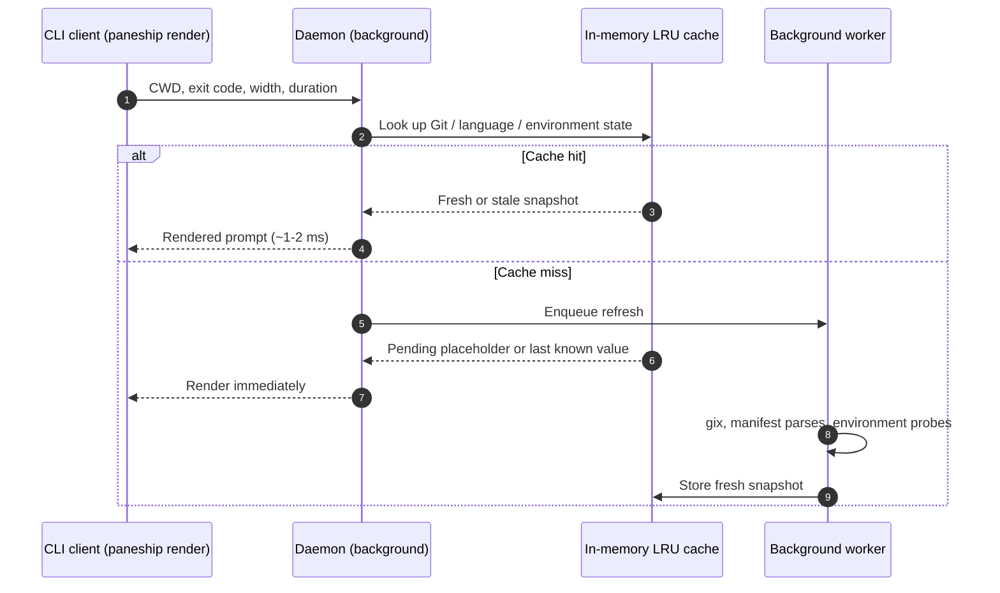

<div align="center">


# Paneship

**A fast, high-performance shell prompt optimized for tmux and large Git repositories.**

[](https://crates.io/crates/paneship)
[](https://github.com/andev0x/paneship/actions/workflows/ci.yml)
[](./LICENSE)
[](./Cargo.toml)
[](#requirements-and-platform-support)
[](https://github.com/andev0x/paneship/stargazers)

[Features](#features) • [Installation](#installation) • [Shell setup](#shell-setup) • [Configuration](#configuration) • [Architecture](#architecture) • [Benchmarks](#benchmarks) • [CLI](#cli) • [Documentation](#documentation)

</div>

---

## About

**Paneship** is a fast, customizable command-line prompt written in Rust. It is
designed for developers who work in terminal multiplexers such as tmux, manage
large Git repositories, and expect the shell to stay responsive.

A persistent background daemon, asynchronous Git checks, and smart cache
invalidation keep the render path at roughly **2.5 ms**, even in large
monorepos.

---

## Features

- **Bounded render path** – A client-daemon architecture keeps expensive work
  off the foreground prompt process.
- **Non-blocking async detection** – Git status, language versions, and
  infrastructure signals are resolved by background workers. Metadata never
  blocks the render path; explicit placeholders fill in until a worker reports
  back.
- **Modular detector registry** – Every language implements a single `Detector`
  trait in its own file, reading version pins directly from `Cargo.toml`,
  `package.json`, `go.mod`, `pyproject.toml`, and similar manifests. No external
  version subprocess is spawned.
- **Interactive configurator** – `paneship config` opens a TUI with a live
  prompt preview, atomic saves, and daemon hot reload.
- **Icon sets and themes** – Built-in `nerdfont` (default, emoji-free), `emoji`
  (explicit opt-in), and `minimal` (ASCII) profiles, plus colour themes.
- **Multi-shell support** – Integration scripts for Zsh, Bash, Fish, PowerShell,
  Nushell, Elvish, Xonsh, Tcsh, Ion, and Cmd.
- **tmux-aware layout** – Detects pane width changes and truncates long paths or
  metadata instead of wrapping.
- **Git integration** – Branch status plus staged, unstaged, and untracked
  counts, computed efficiently with `gix`.
- **Runtime and package detection** – Rust, Node, Bun, Deno, Go, Python, Ruby,
  PHP, and Java versions, plus Cargo package versions.
- **Native right prompt (RPROMPT)** – Zsh (`RPROMPT`/`RPS1`), Fish
  (`fish_right_prompt`), and Nushell (`PROMPT_COMMAND_RIGHT`) bind the width-aware
  right region natively. Low-priority elements collapse first in narrow panes.
- **Infrastructure detectors** – Kubernetes context/namespace, container
  markers, AWS/GCP/Azure profiles, and Nix/Direnv state, each capped at a 10 ms
  background budget.
- **Live telemetry** – `paneship top` streams worker utilization, cache hit
  ratios, lookup latency, LRU evictions, and watcher throughput.
- **Command timing** – Displays long-running command durations such as `11ms`
  or `1m20s`.

---

## Demo

<div align="center">
  
</div>

---

## Requirements and platform support

- **Rust:** 1.88 or newer (MSRV) for source builds.
- **Shell:** any supported shell listed in [Shell setup](#shell-setup).
- **Terminal:** a Nerd Font is recommended for the default profile; use
  `minimal` or `emoji` if needed.
- **tmux:** optional, but the layout and width handling are tuned for it.

| Platform | Architecture | Status |
| -------- | ------------ | ------ |
| Linux | x86_64, aarch64 | Supported |
| macOS | Intel, Apple Silicon | Supported |
| Windows | x86_64 | Supported (compile-verified in CI; runtime reports welcome) |
| WSL2 | x86_64, aarch64 | Supported through the Unix socket transport |

---

## Installation

### One-line installer (recommended)

Downloads a prebuilt binary for your platform and falls back to building from
source when necessary:

```bash
curl -fsSL https://raw.githubusercontent.com/andev0x/paneship/main/install.sh | bash
```

Pass `--version <tag>`, `--dir <path>`, or `--from-source` to control the
install:

```bash
./install.sh --from-source --dir "$HOME/.local/bin"
```

### Using Cargo

```bash
cargo install paneship
```

### From source

```bash
git clone https://github.com/andev0x/paneship.git
cd paneship
cargo install --locked --path .
```

Verify the installation:

```bash
paneship --version
```

---

## Shell setup

Paneship can configure itself automatically or be integrated manually.

### Automatic onboarding (recommended)

`--onboarding` detects the shell configuration file, appends or updates a
marker-delimited block, and keeps the block idempotent. It also starts the
background daemon.

```bash
paneship init zsh --onboarding
```

`paneship init <shell> to onboarding` is an accepted alias. Onboarding is
supported for Zsh, Bash, Fish, PowerShell, Nushell, Elvish, Xonsh, Tcsh, and
Ion.

### Manual configuration

Add the corresponding snippet to your shell configuration file. Manual setup
still needs the daemon for optimal performance; the generated hooks start it
when `paneship daemon ping` fails.

<details>
<summary><b>Zsh (<code>~/.zshrc</code>)</b></summary>

```bash
eval "$(paneship init zsh)"
```
</details>

<details>
<summary><b>Bash (<code>~/.bashrc</code>)</b></summary>

```bash
eval "$(paneship init bash)"
```
</details>

<details>
<summary><b>Fish (<code>~/.config/fish/config.fish</code>)</b></summary>

```fish
paneship init fish | source
```
</details>

<details>
<summary><b>PowerShell (<code>$PROFILE</code>)</b></summary>

```powershell
Invoke-Expression (& paneship init powershell)
```
</details>

<details>
<summary><b>Nushell (<code>config.nu</code>)</b></summary>

```nushell
mkdir ~/.cache/paneship
paneship init nushell | save --force ~/.cache/paneship/init.nu
source ~/.cache/paneship/init.nu
```
</details>

<details>
<summary><b>Other shells</b></summary>

For Elvish, Xonsh, Tcsh, Ion, and Cmd, evaluate or source the output of:

```bash
paneship init <shell>
```
</details>

---

## Configuration

Configuration lives at `~/.config/paneship/config.toml`. Missing files and
invalid TOML fall back to built-in defaults. Run `paneship config` for an
interactive editor with a live preview.

Prompt glyphs and colours resolve from an **icon profile** and **theme**, so you
rarely set individual icons:

```toml
[icons]
profile = "nerdfont"   # nerdfont (default) | emoji (opt-in) | minimal

[theme]
name = "default"       # default | dracula | nord | tokyo-night | gruvbox

[prompt]
rprompt = true         # render the right-aligned telemetry region
rprompt_min_width = 20 # below this width the right region is dropped

[environment]
enabled = true
kubernetes = true
docker = true
cloud = true
nix_direnv = true
health = false         # opt-in CPU load pressure / low battery

[directory]
truncation_length = 3
truncate_to_repo = true
```

> **Glyph policy:** the default `nerdfont` profile contains no raw emoji, only
> Nerd Font glyphs and standard geometric symbols such as the `❯` prompt cursor.
> The `emoji` profile is an explicit opt-in and is never selected by default.
>
> **Layout contract:** the left prompt is reserved for context: the cursor, the
> shortened working directory, Git state, and the project version. The path is
> pure text and is never prefixed by a folder, language, or OS glyph. Host OS
> glyphs, infrastructure badges, runtime versions, command duration, and the
> clock are right-aligned telemetry.

The complete field reference, colour codes, environment variables, and reload
behavior are in **[docs/configuration.md](docs/configuration.md)**.

---

## Architecture

Paneship uses a lightweight **client-daemon-worker** architecture:



### Smart invalidation

The daemon watches each active repository's Git metadata: `.git/HEAD`,
`.git/index`, `.git/packed-refs`, `.git/refs/` (heads, remotes, tags), and the
metadata files directly under `.git`. Bursts of events from `git rebase` or
`git checkout` are coalesced with a 50 ms debounce.

Shell hooks also send an explicit `invalidate` signal after any command starting
with `git `, so operations such as `git push` and `git fetch` are reflected on
the next prompt without waiting for a filesystem event.

### Cache and fallback guarantees

Git state is held in an in-memory LRU store (default: 500 working directories)
with a 5-second TTL. Expired entries are served immediately while a worker
refreshes them. If a repository is known but its state cannot be computed within
the first-render budget, Paneship renders `[git...]` instead of silently
dropping the segment and logs the failure to
`~/.cache/paneship/daemon.log`.

Metadata caches use independent TTLs, configurable with
`PANESHIP_LANG_TTL_MS`, `PANESHIP_PACKAGE_TTL_MS`, and `PANESHIP_ENV_TTL_MS`.
See [docs/architecture.md](docs/architecture.md) for the full design, the IPC
protocol, detector extension points, and reliability guarantees.

---

## Benchmarks

Measured on an Apple Silicon (M-series) host with a target budget of 4 tmux
panes. Run `paneship benchmark` to reproduce on your hardware.

| Stage | Average | Notes |
| ----- | ------- | ----- |
| **Paneship render (in-process, 4 panes)** | **~0.35 ms** | `paneship benchmark` — ~344 µs average |
| **Daemon IPC + render round trip** | **< 1 ms** | Delta over a bare process spawn |
| Process startup (shell `exec`) | ~8 ms | Fixed OS cost paid by every prompt engine |
| Paneship (cold start, no daemon) | ~35 ms | Bounded first-render Git compute |
| Starship Prompt | ~20 ms | |
| Oh My Zsh (default setup) | ~150 ms+ | Noticeable lag |

The render path stays inside the **2.5 ms** target because Git `gix` status,
manifest parsing, and infrastructure probes run in background workers, and the
daemon serves cached regions over a local socket.

> The benchmark pins a fixed width. Resolving the terminal width inside the
> timed loop can spawn `tmux` and would measure process startup instead of the
> render path.

---

## CLI

| Command | Description |
| ------- | ----------- |
| `paneship render` | Render the prompt (also the default with no arguments). |
| `paneship init <shell>` | Print or install shell integration. |
| `paneship config` | Open the interactive TUI configurator. |
| `paneship daemon [ping\|reload]` | Start, check, or reload the daemon. |
| `paneship invalidate [--cwd <path>]` | Tell the daemon that Git state changed. |
| `paneship benchmark` | Measure the render path. |
| `paneship top` | Show live daemon telemetry. |
| `paneship --version` / `paneship help` | Print version or usage. |

Common examples:

```bash
paneship render --shell zsh --layout split
paneship render --cwd /path/to/repo --exit-code 1 --width 100
paneship benchmark --iterations 300 --panes 4 --compare-starship
paneship top --once
```

The full command, flag, output-format, and exit-code reference is in
**[docs/cli.md](docs/cli.md)**.

---

## Troubleshooting

### Icons show as boxes or garbled text

The default `nerdfont` profile needs a patched Nerd Font. Switch profiles if you
cannot install one:

```toml
[icons]
profile = "minimal"   # or "emoji"
```

Run `paneship config` to change profiles with a live preview.

### Git updates or metadata are missing

Check the daemon and force a refresh:

```bash
paneship daemon ping
paneship invalidate --cwd "$PWD"
```

More diagnostics, including logs, placeholders, narrow panes, and reset steps,
are in **[docs/troubleshooting.md](docs/troubleshooting.md)**.

---

## Documentation

| Document | Contents |
| -------- | -------- |
| [Documentation index](docs/README.md) | Start here for all guides |
| [Configuration](docs/configuration.md) | `config.toml`, profiles, themes, environment variables |
| [CLI reference](docs/cli.md) | Commands, flags, wire formats, exit codes |
| [Architecture](docs/architecture.md) | Process model, IPC, caching, detectors, rendering |
| [Troubleshooting](docs/troubleshooting.md) | Icons, daemon, stale state, logs, reset |
| [Releasing](docs/releasing.md) | Versioning, release checklist, artifacts |
| [Contributing](CONTRIBUTING.md) | Development setup, tests, coding standards |
| [Changelog](CHANGELOG.md) | Release history |
| [Support](SUPPORT.md) | Where to ask questions and how to collect diagnostics |
| [Security policy](SECURITY.md) | Supported versions and private reporting |
| [Code of Conduct](CODE_OF_CONDUCT.md) | Community expectations |

---

## Roadmap

### Core enhancements

- [x] **Cross-platform daemon** – IPC abstracted behind an `IpcListener` trait
  with Unix domain socket and Windows named pipe adapters.
- [x] **Interactive configurator** – A TUI (`paneship config`) for themes,
  profiles, and prompt settings.
- [x] **Right-side prompt (RPROMPT)** – Width-aware native right prompts for Zsh,
  Fish, and Nushell, with priority-based collapse.
- [x] **Windows named-pipe hardening** – User-scoped ACLs, remote-client
  rejection, and `ERROR_PIPE_BUSY` backoff.
- [ ] **WASM plugin system** – User-defined prompt modules compiled to
  WebAssembly.

### Modules

- [x] **Infrastructure suite** – Kubernetes, container, cloud, and Nix/Direnv
  detection with per-detector budgets.
- [x] **System health (opt-in)** – CPU load pressure and low-battery indicators.
- [x] **Per-detector cache TTLs** – Independent Git, language, package, and
  environment TTLs.
- [ ] **Package-manager updates** – Background checks for `brew`, `apt`, or
  `cargo`.

### Developer experience

- [x] **One-line installer** – Prebuilt downloads with a Cargo source fallback.
- [ ] **Editor integrations** – Optimized rendering for VS Code and JetBrains
  integrated terminals.
- [ ] **Enhanced onboarding** – More esoteric shells and WSL2 setup.

---

## Contributing

Contributions of all sizes are welcome: bug reports, documentation fixes,
detectors, shell integrations, and performance work.

1. Read [CONTRIBUTING.md](CONTRIBUTING.md).
2. Run `make check` before opening a pull request.
3. Use the issue and pull-request templates.
4. Follow the [Code of Conduct](CODE_OF_CONDUCT.md).

Please do not report security vulnerabilities in public issues. See
[SECURITY.md](SECURITY.md).

---

## License

Distributed under the MIT License. See [LICENSE](./LICENSE) for details.

---

<div align="center">

Made with ❤️ by the Paneship community

</div>
