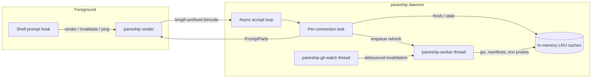

# Architecture

Paneship is designed around one hard constraint: **the prompt must render before
the user notices it**. Everything expensive is moved off the render path, and
every shortcut is allowed to fall back to a previously cached value or an
explicit placeholder rather than blocking.

This guide describes the implementation in `src/` as of Paneship 1.2.

## Design goals

1. **Bounded render latency.** No filesystem walk, manifest parse, or Git status
   computation runs synchronously in the foreground prompt process unless the
   daemon is unavailable and a short bounded fallback is required.
2. **Never silently drop a segment.** A pending Git or language signal renders
   `[git...]` or `[lang...]` instead of disappearing.
3. **Crash isolation.** A bad repository, detector, or detector panic must not
   take down the daemon.
4. **Shell-agnostic core.** The renderer produces structured regions; each shell
   adapter only handles quoting, escaping, and native right-prompt binding.
5. **Local-only operation.** There is no network listener, no telemetry, and no
   remote service.

## Process model



### Foreground CLI

`src/main.rs` parses arguments and, for `render`, calls the daemon client. The
client uses blocking I/O with 15 ms read and write timeouts, so it never needs
to construct an async runtime. If the daemon is unreachable, the CLI renders
locally using the same modules, with a 30 ms bounded Git computation.

No arguments means `render`. The CLI is deliberately small because every
millisecond of process startup is paid on every prompt.

### Daemon

`src/daemon/mod.rs` starts a two-thread Tokio runtime and an async accept loop.
Each connection is handled by a spawned task. Expensive work is sent to a
dedicated `paneship-worker` thread through a channel; the watcher runs on a
separate `paneship-git-watch` thread.

The daemon exits when another daemon is already listening, reclaims a stale
socket, and periodically compares its executable's modified time and length. If
the binary is replaced (for example by `cargo install` or an upgrade), the old
daemon retires itself so the next prompt starts the new one instead of rendering
with stale logic.

## Request lifecycle

1. The shell hook invokes `paneship render` with the current directory, exit
   code, terminal width, and optional command duration.
2. The client connects to the local endpoint and sends a `Request::Render`.
3. The daemon resolves Git, language, package, and environment state from cache.
4. A fresh entry is returned immediately. A stale entry is returned while a
   refresh is queued. A missing entry queues a refresh; Git may additionally run
   a first-render computation bounded to 30 ms.
5. The daemon builds a `PromptContext`, calls `core::renderer::render_parts`,
   and returns `PromptParts { left, right, cursor }`.
6. The CLI applies shell-specific escaping and either combines the regions or
   emits the split wire format for a native right prompt.

## IPC protocol

The transport is a platform-native local socket:

- Unix domain socket on macOS, Linux, and WSL2 at
  `$XDG_RUNTIME_DIR/paneship.sock`, then
  `~/.cache/paneship/paneship.sock`, then a per-user temp path.
- User-scoped named pipe on Windows at `\\.\pipe\paneship-<user>`, with a DACL
  for the current user and remote clients rejected.

Framing is a 4-byte big-endian payload length followed by a `bincode` payload.
Frames larger than **4 MiB** are rejected before allocation. Requests and
responses are Rust enums:

| Request | Purpose |
| ------- | ------- |
| `GetGit` | Cached or computed Git state for one path |
| `Render` | Resolve all regions and render a prompt |
| `NotifyGit` | Store a Git snapshot computed elsewhere |
| `InvalidateCwd` | Clear and refresh state after a `git` command |
| `ReloadConfig` | Re-read `config.toml` and clear metadata caches |
| `Ping` | Liveness check used by shell hooks |
| `Stats` | Telemetry snapshot for `paneship top` |

| Response | Purpose |
| -------- | ------- |
| `Git` | Git resolution, including pending/stale state |
| `Rendered` | Structured prompt regions |
| `Pong` | Daemon is alive |
| `Ok` | Acknowledgement |
| `Stats` | Live telemetry |

The client applies 15 ms timeouts to both directions. A timeout or decode error
is treated as "daemon unavailable" and never panics the prompt.

## Caching

`src/cache/mod.rs` holds several in-memory LRU caches. The default capacity is
**500 entries per cache**, configurable with `PANESHIP_CACHE_CAPACITY`.

| Cache | Key | Default TTL | Override |
| ----- | --- | ----------- | -------- |
| Git | Repository root | 5 s | `PANESHIP_GIT_TTL_MS` |
| Language | Marker file | 60 s | `PANESHIP_LANG_TTL_MS` |
| Package | `Cargo.toml` | 120 s | `PANESHIP_PACKAGE_TTL_MS` |
| Environment | Working directory | 30 s | `PANESHIP_ENV_TTL_MS` |
| Repository root | Working directory | LRU lifetime | none |

Metadata entries also record the source file's modification time. If the
manifest changes, the entry is treated as missing even when its TTL has not
expired.

### Fresh, stale, and pending

- **Fresh:** inside the TTL and usable immediately.
- **Stale:** past the TTL but carrying the last value. The render uses it and
  queues a refresh.
- **Pending:** a refresh is in flight. The render uses an explicit placeholder.

This is the stale-while-revalidate contract: correctness converges in the
background, while latency stays bounded.

## Invalidation

There are two paths:

1. **Filesystem watcher.** For every repository the daemon renders, it watches
   `.git/HEAD`, `.git/index`, `.git/packed-refs`, `.git/refs/` recursively, and
   the `.git` directory itself for files such as `ORIG_HEAD`. Events are
   coalesced with a **50 ms debounce** before the affected Git entry is
   invalidated and refreshed.
2. **Explicit shell hook.** After a command beginning with `git `, the shell
   integration sends `InvalidateCwd` for the current directory. This catches
   remote-tracking updates from `git push`/`git fetch` even when the local
   refs did not change in a watched location. The handler also clears cached
   repository-root decisions for the path and its ancestors, so `git init` and
   deleting a repository are reflected immediately.

A deduplication set prevents the same refresh kind from being queued twice for
the same path while a worker is busy.

## Detector registry

Language and runtime detectors live in `src/detectors/`. Each implements the
`Detector` trait:

```rust
#[async_trait]
pub trait Detector: Send + Sync {
    fn name(&self) -> &'static str;
    fn marker_files(&self) -> &'static [&'static str];
    fn marker_in(&self, dir: &Path) -> Option<PathBuf>;
    async fn detect(&self, cwd: &Path) -> Option<RuntimeInfo>;
}
```

The registry is a static list built in `src/detectors/mod.rs`. A marker probe
walks upward from the working directory, stops at the repository root or the
user's home directory, and only performs existence checks. Manifest parsing is
**manifest-first** and subprocess-free: no `node -v`, `python --version`, or
similar command is spawned on the prompt path.

Infrastructure detectors (`src/detectors/infra/`) are best-effort. Each runs in
a detached worker with a hard **10 ms** budget (250 ms for the opt-in health
check, which may invoke `pmset` on macOS). A timeout, I/O error, or panic drops
only that provider's signal.

## Rendering pipeline

`src/core/renderer.rs` splits rendering into two independent pipelines:

- **Left:** cursor-adjacent context only — shortened directory, Git state, and
  project version.
- **Right:** telemetry only — OS/environment identification, runtime version,
  command duration, and clock.

The split is an architectural invariant. OS and infrastructure icons can never
become a directory prefix, so `cd`, `z`, or jumping between projects cannot leak
a platform logo into the left prompt.

### Width allocation

1. Render the right region first.
2. Reserve its visible width, leaving at least a small left budget.
3. Lay out the left region within the remaining columns.
4. Collapse right-side elements by priority when the terminal is narrow:

| Priority | Element | Survives longest |
| -------- | ------- | ---------------- |
| 110 | OS identification | Yes |
| 100 | Language/runtime | Then |
| 80 | Clock | Then |
| 70 | Environment/infrastructure | Then |
| 60 | Command duration | Collapses first |

Below `prompt.rprompt_min_width` (default 20 columns) the right region is
dropped entirely rather than risking a wrapped line.

### Split wire format

For native right prompts, `paneship render --layout split` emits:

```text
<left><US><right>\n<cursor>
```

`<US>` is ASCII unit separator (`0x1f`). Each region is shell-escaped before it
is joined, so Zsh `%{...%}` and Bash `\[...\]` non-printing sequences are
measured correctly. Zsh binds `PROMPT`/`RPROMPT`, Fish binds `fish_right_prompt`,
and Nushell binds `PROMPT_COMMAND_RIGHT`; the shell owns the actual alignment.

## Shell integration

`paneship init <shell>` prints an integration script. With `--onboarding` (or the
`to onboarding` alias), the CLI writes a marker-delimited block into the shell's
configuration file and updates it in place on later runs.

The generated hooks:

- start the daemon when `paneship daemon ping` fails;
- capture command start time before execution;
- consume `fish`/`zsh`/`bash` command status;
- call `invalidate` after `git` commands;
- render with the correct shell mode and layout;
- fall back to a minimal prompt (Zsh and Fish) if rendering returns nothing.

Supported targets: Bash, Zsh, Fish, PowerShell, Nushell, Elvish, Xonsh, Tcsh,
Ion, and Cmd (with the documented limitations of Cmd).

## Reliability and security

- Worker refreshes are wrapped in `catch_unwind`, so one bad repository cannot
  kill the daemon.
- The daemon uses only local IPC; there is no TCP listener or HTTP server.
- Frames are capped at 4 MiB. Manifest and infrastructure config reads are
  capped at 512 KiB and 256 KiB respectively.
- Stale Unix sockets are detected by attempting a connection and removed only
  when no daemon is listening.
- Windows pipes use a current-user DACL and reject remote clients.
- Configuration is local and user-owned; the daemon runs with user privileges.
- Warnings and panics are appended to `~/.cache/paneship/daemon.log`. Set
  `PANESHIP_DAEMON_DEBUG=1` to echo them to stderr.

See [SECURITY.md](../SECURITY.md) for the threat model and reporting process.

## Module map

| Path | Responsibility |
| ---- | -------------- |
| `src/main.rs` | CLI parsing, shell init scripts, onboarding |
| `src/core/config.rs` | TOML loading, defaults, hot reload |
| `src/core/icons.rs` | Icon profiles, themes, OS/environment glyphs |
| `src/core/layout.rs` | ANSI handling, visible width, truncation |
| `src/core/prompt.rs` | Render inputs and metadata state |
| `src/core/renderer.rs` | Left/right pipelines and region composition |
| `src/modules/` | Directory, Git, status, metadata, package, environment segments |
| `src/detectors/` | Language/runtime registry plus infrastructure detectors |
| `src/cache/` | LRU caches, TTLs, repository-root resolution |
| `src/daemon/` | Async server, worker, watcher, telemetry, logging |
| `src/ipc/` | Platform transport (Unix socket, Windows named pipe) |
| `src/tui/` | `paneship config` editor and atomic save |
| `src/benchmark.rs` | Render benchmark and component micro-benchmark |
| `src/top.rs` | Live telemetry view and JSON snapshots |

## Extending Paneship

### Add a language detector

1. Create `src/detectors/<language>.rs` implementing `Detector`.
2. Return the canonical key from `name()`; it is used for config and icon
   lookup.
3. List marker files in priority order.
4. Parse versions with the bounded helpers in `src/detectors/manifest.rs`.
5. Register the detector in `build_registry()`.
6. Add its icon to each profile in `src/core/icons.rs` if it should have one.
7. Add tests for marker discovery and version extraction.

### Add a shell

1. Add a variant to `RenderShell`.
2. Implement its init script and, if applicable, onboarding target.
3. Map the shell name in `parse_init_args` and `--shell`.
4. Test the generated script with `paneship init <shell>`.

### Add a CLI command

1. Add a `CliCommand` variant.
2. Parse it in `parse_cli` and document it in [cli.md](cli.md).
3. Keep the hot render path allocated and synchronous; use the daemon for
   anything expensive.

## Performance methodology

`paneship benchmark` measures the in-process render path with a fixed width and
multiple panes. It intentionally avoids resolving the terminal width during the
timed loop, because that can spawn `tmux` and would measure process startup
instead of rendering.

- Run `paneship benchmark` for the current machine.
- Use `paneship benchmark --compare-starship` for a local comparison if
  Starship is installed.
- Use `paneship top` for live daemon behavior and `paneship top --benchmark`
  for per-component timings.
- Treat absolute numbers as hardware-specific. The invariant is the budget:
  cached renders should stay well below the 2.5 ms target.
