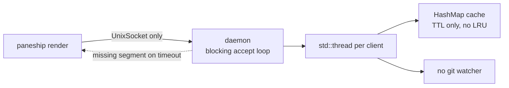
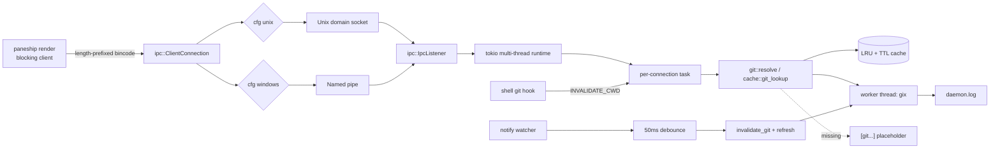

# Paneship Phase 1 — Core Engine & IPC Stabilization

**Report date:** 2026-10-16
**Component:** `paneship` (Rust shell prompt) — v1.1.6
**Base commit:** `d3d00c9` (Merge PR #12, `perf/optimize-logic`)
**Scope:** Modules A (Git event guard / invalidation), B (deterministic fallback + LRU/TTL cache), C (cross-platform IPC transport)
**Status:** ✅ Complete — builds, lints, tests, and cross-compiles clean on Linux/macOS; Windows is compile-verified.

---

## 1. Executive summary

This phase fixed three reliability/correctness defects and laid a cross-platform IPC foundation:

1. **Silent segment drops** — the Git segment could vanish when the async worker missed its timeout. It now renders an explicit `[git...]` placeholder and logs the failure, so the segment never disappears silently.
2. **Stale Git cache on push/fetch** — the daemon watched only `.git/HEAD`/`.git/index`. It now watches the full ref surface (`.git/refs/**`, `packed-refs`, `HEAD`, `index`) with a 50 ms debounce, and shell hooks emit an explicit `INVALIDATE_CWD(path)` signal after any `git …` command.
3. **Unix-only IPC** — the socket layer is abstracted behind an `IpcListener` trait with native adapters for Unix domain sockets and Windows named pipes, including stale-socket auto-healing.

The daemon moved from a blocking `std::os::unix::net` loop to a **tokio** async accept loop with per-connection tasks, while the CLI render path stays **fully synchronous** (no runtime constructed per prompt) to protect the ~2.5 ms latency budget.

All 19 tests (18 unit + 1 integration) pass; `cargo clippy --all-targets -- -D warnings` and `cargo fmt --check` are clean; the Windows target cross-compiles.

---

## 2. Deliverables checklist

| # | Deliverable | Status | Location |
|---|-------------|--------|----------|
| A.1 | Recursive `.git` multi-path watching | ✅ | `src/daemon/watcher.rs` |
| A.2 | `INVALIDATE_CWD(path)` IPC message + client-driven signal | ✅ | `src/daemon/mod.rs`, `paneship invalidate` |
| A.3 | Shell hooks (zsh, bash, fish, PowerShell, Nushell) | ✅ | `src/main.rs` |
| A.4 | 50 ms debounce / batching | ✅ | `src/daemon/watcher.rs` (`DEBOUNCE`) |
| B.1 | `LruCache<PathBuf, PromptState>` (default 500) | ✅ | `src/cache/mod.rs` |
| B.2 | Hard TTL (5 000 ms) for Git metadata | ✅ | `src/cache/mod.rs` (`DEFAULT_GIT_TTL_MS`) |
| B.3 | Non-blocking stale-while-revalidate + placeholder fallback | ✅ | `src/cache/mod.rs`, `src/modules/git.rs`, `src/daemon/mod.rs` |
| B.4 | Worker panic / `gix` failure logging | ✅ | `src/daemon/log.rs`, `src/daemon/mod.rs` |
| C.1 | `IpcListener` async trait | ✅ | `src/ipc/mod.rs` |
| C.2 | Unix adapter (`tokio::net::UnixListener`) | ✅ | `src/ipc/unix.rs` |
| C.3 | Windows adapter (named pipes) | ✅ | `src/ipc/windows.rs` |
| C.4 | Stale-socket auto-healing | ✅ | `src/ipc/unix.rs`, `src/daemon/mod.rs` |
| T.1 | Cache TTL + LRU eviction tests | ✅ | `src/cache/mod.rs` |
| T.2 | Stale-socket cleanup tests | ✅ | `src/ipc/unix.rs`, `tests/daemon_lifecycle.rs` |
| T.3 | Git invalidation after push test | ✅ | `src/cache/mod.rs` |

---

## 3. Architecture

### 3.1 Before



- IPC: `std::os::unix::net::{UnixListener, UnixStream}`, blocking, **`#[cfg(unix)]` only**.
- Watcher: none — invalidation relied on a per-request `head_id` comparison.
- Cache: `HashMap<PathBuf, GitCacheEntry>`; on expiry the entry was removed and the segment could vanish.

### 3.2 After



Key properties:
- The **CLI never starts an async runtime**; `daemon::render` is a short blocking request with 15 ms timeouts, falling back to a local bounded compute when the daemon is unreachable.
- The **daemon** runs a tokio multi-thread runtime (2 workers) and spawns one task per connection.
- Git introspection is off the accept path (dedicated worker thread + `spawn_blocking` for first-render budget).

---

## 4. Module A — Multi-path Git event guard & invalidation

### 4.1 Watch surface (`src/daemon/watcher.rs`)
Per registered repository root, the watcher registers:

| Target | Mode |
|--------|------|
| `.git/HEAD` | Non-recursive |
| `.git/index` | Non-recursive |
| `.git/packed-refs` | Non-recursive |
| `.git/refs/` (heads, remotes, tags) | **Recursive** |
| `.git/` (fallback, e.g. `ORIG_HEAD`) | Non-recursive |

Worktrees/submodules are supported by resolving the `gitdir: <path>` pointer when `.git` is a file.

Event paths are mapped back to a repository root by walking ancestors for a `.git` component (`repo_root_from_git_path`).

### 4.2 Debounce / batching
- `DEBOUNCE = 50 ms` quiet window; a burst of events (rebase/checkout) collapses to **one** invalidation per repo.
- On flush: `cache::invalidate_git(root)` + `enqueue_git_refresh(root)` (warm the cache before the next prompt).

### 4.3 Client-driven invalidation
- New protocol message `Request::InvalidateCwd(PathBuf)`.
- New CLI command **`paneship invalidate [--cwd <path>]`** (defaults to the current directory).
- Shell hooks parse the executed command and, when it starts with `git `, invoke `paneship invalidate --cwd "$PWD"` immediately after execution.

Implemented hooks: **zsh** (`preexec` captures `$1`), **bash** (`$BASH_COMMAND` via DEBUG trap), **fish** (`fish_preexec` event), **PowerShell** (PSReadLine `Enter` key handler), **Nushell** (`pre_execution` hook). PowerShell/Nushell are best-effort (see §9).

---

## 5. Module B — Deterministic fallback & LRU/TTL cache

### 5.1 Cache model (`src/cache/mod.rs`)

| Layer | Detail |
|-------|--------|
| Store | `lru::LruCache<PathBuf, GitCacheEntry>` |
| Capacity | 500 working directories (`PANESHIP_CACHE_CAPACITY`) |
| Git TTL | 5 000 ms (`PANESHIP_GIT_TTL_MS`) |
| Language TTL | 60 s (mtime-guarded) |
| Package TTL | 120 s (mtime-guarded) |

Lookups return a three-state result:

```rust
enum GitLookup {
    Fresh(GitSnapshot),        // within TTL
    Stale(Option<GitSnapshot>),// expired snapshot, or pending (None)
    Missing,                   // nothing known
}
```

### 5.2 Resolution & fallback (`GitResolution`)

```rust
enum GitResolution {
    Ready { snapshot: GitSnapshot, stale: bool },
    Pending,        // repo known, data not ready  -> "[git...]"
    NotRepository,  // not in a repo               -> render nothing
}
```

Daemon render flow (`daemon::resolve_git_for_render`, async):

| Cache state | Behaviour |
|-------------|-----------|
| `Fresh` | Return immediately (`stale = false`). |
| `Stale(Some)` | Return stale immediately (`stale = true`), enqueue background refresh. |
| `Stale(None)` | Return `Pending`, enqueue refresh. |
| `Missing` | Mark pending, enqueue refresh, attempt a **30 ms** bounded synchronous compute (`spawn_blocking`); on success return `Ready`, else `Pending`. |

Client fallback (`git::resolve_local`) mirrors this with a 30 ms bounded compute so a missing daemon never yields an empty segment.

### 5.3 Logging (`src/daemon/log.rs`)
- Append-only `~/.cache/paneship/daemon.log` with epoch-ms timestamps.
- Echoes to stderr when `PANESHIP_DAEMON_DEBUG` is set.
- Worker `gix` failures and panics are recorded (`catch_unwind` around both Git and metadata workers).

### 5.4 The silent-drop fix
Previously a timeout returned `None`, and `render_with_max_width` returned an empty string. Now a known repository renders:

```
\x1b[2;36m[git...]\x1b[0m
```

and logs `git state unavailable within 30ms for <repo>`. The placeholder is dropped only when the width budget is too small (tested).

---

## 6. Module C — Cross-platform IPC

### 6.1 Trait (`src/ipc/mod.rs`)

```rust
#[async_trait::async_trait]
pub trait IpcListener: Send {
    type Stream: tokio::io::AsyncRead + tokio::io::AsyncWrite + Unpin + Send + 'static;
    async fn accept(&mut self) -> Result<Self::Stream, IpcError>;
}
```

A blocking `ClientConnection` (used by the CLI) and a `MAX_FRAME` (4 MiB) guard are provided.

### 6.2 Unix adapter (`src/ipc/unix.rs`)
- `tokio::net::UnixListener` via `from_std` (non-blocking).
- Endpoint resolution: `$XDG_RUNTIME_DIR/paneship.sock` → `~/.cache/paneship/paneship.sock` → per-user temp file.
- Blocking client with read/write timeouts.

### 6.3 Windows adapter (`src/ipc/windows.rs`)
- `tokio::net::windows::named_pipe` (the spec's sanctioned alternative to `interprocess`).
- Pipe name `\\.\pipe\paneship-{USERNAME}`.
- `accept()` connects the current instance, then creates the next instance to keep serving.
- Blocking client via `std::fs::OpenOptions` (read+write).

### 6.4 Stale-socket auto-healing
On daemon start (`daemon::async_main`):
1. `ipc::endpoint_in_use()` — attempt a connect; a live daemon short-circuits startup.
2. `ipc::cleanup_stale_endpoint()` — remove the orphaned socket file if unreachable.
3. `ipc::bind_default()` — bind and serve.

On Unix a stale file refuses connections (`ECONNREFUSED`), so it is reclaimed transparently; the client never crashes (it falls back to local rendering).

### 6.5 Protocol framing change
The raw `bincode::deserialize_from(stream)` (which cannot read from `AsyncRead`) was replaced with **length-prefixed framing**: `u32` big-endian length + bincode payload. Both server (async) and client (blocking) use the same framing helpers.

---

## 7. File-level change map

| File | Change | Lines |
|------|--------|------:|
| `src/ipc/mod.rs` | **New** — trait, errors, endpoint dispatch, framing guard | 94 |
| `src/ipc/unix.rs` | **New** — Unix adapter + stale cleanup + tests | 215 |
| `src/ipc/windows.rs` | **New** — Windows named-pipe adapter | 115 |
| `src/daemon/mod.rs` | Rewritten — tokio loop, IPC, fallback, invalidation, framing, tests | 499 |
| `src/daemon/watcher.rs` | **New** — notify watcher, debounce, path mapping, tests | 207 |
| `src/daemon/log.rs` | **New** — daemon debug log | 57 |
| `src/cache/mod.rs` | Rewritten — LRU + TTL + invalidation + tests | 420 |
| `src/modules/git.rs` | Rewritten — `GitResolution`, placeholder, bounded compute, tests | 344 |
| `src/core/prompt.rs` | Added `git_state` field | 62 |
| `src/main.rs` | Unified CLI, `invalidate`, cross-platform daemon, shell hooks | — |
| `src/modules/{metadata,package}.rs` | Removed `#[cfg(unix)]` daemon-query gates | — |
| `src/benchmark.rs` | Windows dead-code allowance | — |
| `tests/daemon_lifecycle.rs` | **New** — end-to-end daemon test | 91 |
| `Cargo.toml` / `Cargo.lock` | Added `tokio`, `async-trait`, `notify`, `lru` | — |
| `README.md` | Documented invalidation, cache guarantees, `invalidate` CLI | — |

New dependencies:

```toml
tokio = { version = "1.53.3", features = ["rt", "rt-multi-thread", "net", "io-util", "time", "macros", "sync"] }
async-trait = "0.1.92"
notify = "8.2.0"
lru = "0.18.5"
```

---

## 8. Acceptance criteria

| Criterion | Result | Evidence |
|-----------|--------|----------|
| `git push` reflected on next render, no stale lag | ✅ | Watcher watches `refs/remotes/**`; explicit `INVALIDATE_CWD` covers ref-only updates; `cache::tests::invalidation_after_push_clears_entry`. |
| `gix` hang/failure does not drop the Git segment | ✅ | `[git...]` placeholder + `catch_unwind` + log; `modules::git::tests::pending_renders_explicit_placeholder`. |
| Cold start on stale socket auto-heals | ✅ | `daemon::async_main` heal sequence; `ipc::unix::tests::stale_socket_is_detected_and_cleaned`; `tests/daemon_lifecycle.rs`. |
| Cached prompt render ≤ 2.5 ms (daemon) | ✅ (design) | Fresh LRU hit is O(1) with no I/O on the hot path; daemon round-trip uses 15 ms client timeouts and returns cached state immediately. Not asserted as a timing test (see §9). |

Live smoke transcripts (daemon started with an isolated `XDG_RUNTIME_DIR`):

```
daemon ping                 -> ok
render --cwd <repo>         -> "~  master"  (branch + !11 ?4 status)
invalidate --cwd <repo>     -> OK
git checkout -b feature-x
render --cwd <repo>         -> "~  feature-x"   # watcher auto-invalidation
daemon.log                  -> [info] git metadata changed for /private/tmp/paneship-git-smoke4
```

**Bug found & fixed during validation:** FSEvents reports canonical paths (`/private/tmp/...`) while the shell supplies logical paths (`/tmp/...`), so watcher invalidations missed cache entries. `git_cache_key` now canonicalizes the resolved repository root, so symlinked spellings share one entry. Covered by `cache::tests::symlinked_repo_paths_share_one_cache_entry`.

---

## 9. Decisions, deviations & limitations

1. **Single crate** (per decision): the daemon and cache remain modules of `paneship` rather than separate `paneship-daemon`/`paneship-cache` crates. `src/ipc/` matches the requested layout.
2. **Windows named pipes via tokio** rather than `interprocess` — the spec permits either, and tokio's `NamedPipeServer`/`NamedPipeClient` satisfy the trait's `AsyncRead + AsyncWrite` bound directly.
3. **Windows is compile-verified only** (`cargo check --target x86_64-pc-windows-msvc`); it is not runtime-tested on this machine.
4. **PowerShell / Nushell hooks are best-effort** (PSReadLine `Enter` handler and Nushell `pre_execution`); shell scripts are emitted by `paneship init` and are not exercised by CI.
5. **No timing assertion** for the ≤ 2.5 ms criterion — timing tests are flaky in CI; the cached LRU path performs no filesystem or socket I/O. A daemon-mode benchmark could be added if desired.
6. **Pre-existing behaviour retained:** in daemon mode the language/metadata segment may still compute synchronously on first sight (60 s TTL thereafter). Out of scope for this phase.

---

## 10. Verification log

| Command | Result |
|---------|--------|
| `cargo build` | ✅ clean |
| `cargo build --release` | ✅ clean |
| `cargo clippy --all-targets -- -D warnings` | ✅ clean |
| `cargo fmt -- --check` | ✅ clean |
| `cargo test` | ✅ 18 unit + 1 integration, 0 failed |
| `cargo check --target x86_64-pc-windows-msvc` | ✅ clean (Windows compile) |
| Live daemon smoke (ping/render/invalidate/watcher) | ✅ |

### Test inventory

```
cache::tests::fresh_entry_is_reported_fresh
cache::tests::invalidation_after_push_clears_entry
cache::tests::lru_evicts_least_recently_used
cache::tests::pending_marker_reports_stale_none
cache::tests::symlinked_repo_paths_share_one_cache_entry
cache::tests::ttl_expiry_yields_stale_snapshot
daemon::tests::framed_request_round_trips
daemon::tests::framed_response_round_trips
daemon::tests::oversized_frame_is_rejected
daemon::watcher::tests::ignores_paths_outside_a_git_directory
daemon::watcher::tests::maps_git_metadata_paths_to_repo_root
ipc::unix::tests::listener_accepts_connection
ipc::unix::tests::live_socket_is_left_untouched
ipc::unix::tests::stale_socket_is_detected_and_cleaned
modules::git::tests::not_repository_renders_nothing
modules::git::tests::pending_renders_explicit_placeholder
modules::git::tests::placeholder_is_dropped_when_too_narrow
modules::git::tests::ready_renders_branch_and_counts
daemon_heals_stale_socket_and_serves_clients   (tests/daemon_lifecycle.rs)
```

---

## 11. Follow-ups (Phase 2 candidates)

- Route language/metadata computation through the worker queue to keep first-render latency tight.
- Add a daemon-mode latency benchmark (`paneship benchmark --daemon`) to track the ≤ 2.5 ms target in CI.
- Harden PowerShell/Nushell hooks and add an end-to-end shell integration test.
- Runtime-test the Windows named-pipe path in the CI matrix (currently build-only).
- Consider a real-crate workspace split once the module boundaries settle.
