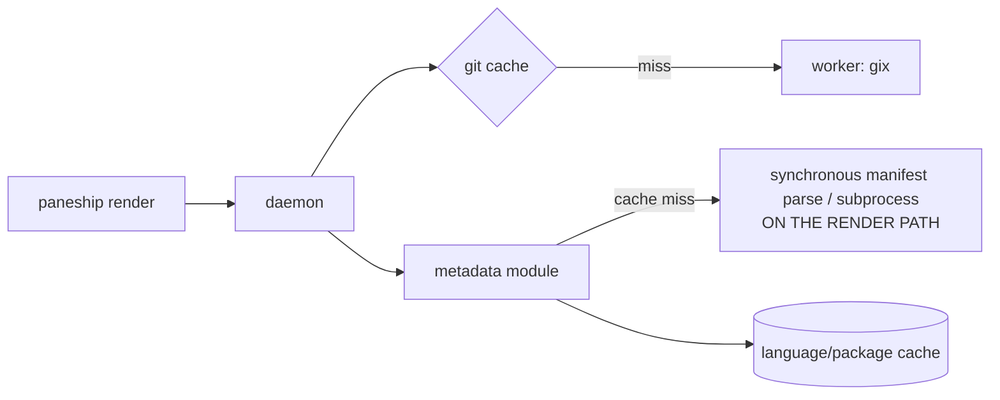
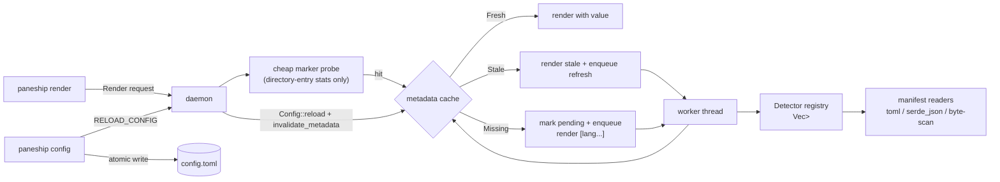

# Paneship Phase 2 — Modular Detectors & TUI Configurator

**Report date:** 2026-10-16
**Component:** `paneship` (Rust shell prompt) — v1.1.6
**Base commit:** `9c9031a` (refactor(core): cache, watcher & IPC)
**Scope:** Modules A (async runtime detection), B (detector registry), C (TUI configurator), D (icon/theme layer)
**Status:** ✅ Complete — builds, lints, formats, and tests clean on macOS (aarch64). Windows cross-check could not run in this environment (see §9).

---

## 1. Executive summary

Phase 2 removes the last synchronous work from the prompt render path, makes language
detection a self-contained plugin system, and adds an interactive configuration tool:

1. **Zero-blocking metadata.** Language and package detection now follow the same
   stale-while-revalidate pattern as Git. On a cache miss or TTL expiry the daemon
   returns an explicit `[lang...]` placeholder and dispatches a manifest parse to the
   worker pool — no synchronous parsing on the render path.
2. **Manifest-first detectors.** Version pins are read directly from `Cargo.toml`,
   `package.json`, `go.mod`, `pyproject.toml`, `.nvmrc`, `rust-toolchain.toml`, … with
   lightweight in-process readers. No external subprocess (`node -v`,
   `python --version`) is ever spawned.
3. **Detector registry.** Every language implements the uniform `Detector` trait in its
   own file; the daemon holds a static `Vec<Box<dyn Detector>>`. Adding a language is a
   one-file change plus one registry line, isolated from the renderer.
4. **`paneship config` TUI.** A `ratatui` + `crossterm` split-pane editor with a live
   prompt preview, atomic `tempfile`-based saves, and a `RELOAD_CONFIG` IPC signal that
   hot-reloads the running daemon.
5. **Icon sets & themes.** `nerdfont`, `emoji` and `minimal` (ASCII) icon profiles plus
   five colour themes resolve every prompt token dynamically, with explicit per-field
   overrides still winning.

All 52 tests (51 unit + 1 integration) pass; `cargo clippy --all-targets -- -D warnings`
and `cargo fmt -- --check` are clean; `cargo build --release` succeeds.

---

## 2. Deliverables checklist

| # | Deliverable | Status | Location |
|---|-------------|--------|----------|
| A.1 | Metadata resolved off the render path with `[lang...]` placeholder | ✅ | `src/daemon/mod.rs`, `src/modules/metadata.rs` |
| A.2 | Three-state language/package lookup + pending marker | ✅ | `src/cache/mod.rs` (`MetadataLookup`) |
| A.3 | Package version routed through the same async pipeline | ✅ | `src/modules/package.rs`, `src/daemon/mod.rs` |
| A.4 | Fast-path manifest parsing, no subprocess | ✅ | `src/detectors/*` |
| A.5 | Independent Git/metadata in-flight guards | ✅ | `src/daemon/mod.rs` (`UpdateKey`) |
| B.1 | `Detector` trait + `RuntimeInfo` | ✅ | `src/detectors/mod.rs` |
| B.2 | Static boxed registry | ✅ | `src/detectors/mod.rs` (`build_registry`) |
| B.3 | Per-language detectors (Rust, Node, Bun, Deno, Go, Python, Ruby, PHP, Java) | ✅ | `src/detectors/{rust,node,bun,deno,go,python,ruby,php,java}.rs` |
| C.1 | `paneship config` CLI entry | ✅ | `src/main.rs`, `src/tui/mod.rs` |
| C.2 | Split-pane layout + live preview | ✅ | `src/tui/ui.rs` |
| C.3 | In-memory TOML editing | ✅ | `src/tui/app.rs` |
| C.4 | Atomic config write | ✅ | `src/tui/persist.rs` |
| C.5 | `RELOAD_CONFIG` IPC + daemon hot-reload | ✅ | `src/daemon/mod.rs`, `Config::reload` |
| C.6 | SIGWINCH / resize-aware redraw | ✅ | `src/tui/mod.rs` (`Event::Resize`) |
| D.1 | `NerdFont` / `Emoji` / `Minimal` icon profiles | ✅ | `src/core/icons.rs` |
| D.2 | Colour theme presets | ✅ | `src/core/icons.rs` |
| D.3 | Dynamic resolution during layout | ✅ | `src/core/config.rs` |
| T.1 | Detector + registry tests | ✅ | `src/detectors/*` |
| T.2 | Cache metadata lifecycle tests | ✅ | `src/cache/mod.rs` |
| T.3 | Config/icon/theme resolution tests | ✅ | `src/core/config.rs`, `src/core/icons.rs` |
| T.4 | TUI state, ANSI parser, atomic-write tests | ✅ | `src/tui/{app,ui,persist}.rs` |
| T.5 | Hot-reload integration test | ✅ | `tests/daemon_lifecycle.rs` |

---

## 3. Architecture

### 3.1 Before (Phase 1 follow-up §11)



- `daemon::Render` resolved Git asynchronously but resolved metadata synchronously via
  `get_or_compute_language` / `get_or_compute_package_version`.
- Detection could spawn `node -v`, `python --version`, `go version`, … inside the project
  directory (bounded by a 150 ms thread timeout, but still on the path).
- Note in the Phase 1 report: *"in daemon mode the language/metadata segment may still
  compute synchronously on first sight."*

### 3.2 After



Key properties:
- The **hot path performs only file-existence checks** (`Detector::marker_in`); parsing
  happens exclusively on the worker.
- Git and metadata refreshes use **independent in-flight keys** so neither suppresses the
  other for the same directory.
- The **registry owns the canonical language key**; `RuntimeInfo.language` is normalised
  from `Detector::name()`.

---

## 4. Module A — Asynchronous runtime detection pipeline

### 4.1 Render-path resolution (`src/daemon/mod.rs`)

`resolve_language_for_render` / `resolve_package_for_render` mirror
`resolve_git_for_render`:

| Cache state | Behaviour |
|-------------|-----------|
| `Fresh(value)` | Return immediately (`stale = false`). |
| `Stale(Some)` | Return stale value (`stale = true`), enqueue refresh. |
| `Stale(None)` | Return `Pending` (→ `[lang...]`), enqueue refresh. |
| `Missing` | `mark_language_pending` + enqueue refresh, return `Pending`. **No synchronous compute.** |

`MetadataState<T>` (`Ready { value, stale } | Pending | Absent`) is added to
`PromptContext` and populated by the daemon's `Render` handler.

### 4.2 Cache model (`src/cache/mod.rs`)

Language and package caches now return a three-state `MetadataLookup<T>`
(`Fresh | Stale(Option<T>) | Missing`), with `mark_*_pending` / `store_*` writers and an
mtime guard per source file. `invalidate_metadata()` clears both on config reload.

### 4.3 Worker refresh

`compute_metadata_for_daemon` probes the registry, runs the matched detector, and stores
the snapshot under the marker path. The shared in-flight set was split into
`UpdateKey { kind: Git | Metadata, path }` so a pending Git refresh no longer blocks a
metadata refresh (a latent Phase 1 issue).

### 4.4 Fast-path parsing

Every detector reads bounded manifests (≤ 512 KiB) in-process. Examples:

- Rust — `rust-toolchain.toml` `[toolchain].channel`, legacy `rust-toolchain`, then
  `[package].rust-version` / `[workspace.package].rust-version`.
- Node — `.nvmrc`, `.node-version`, then `package.json` `volta.node` / `engines.node`.
- Go — `go.mod` `toolchain` / `go` directive (byte scan).
- Python — `.python-version`, `pyproject.toml` `project.requires-python` / Poetry.

---

## 5. Module B — Extensible detector registry

```rust
#[async_trait]
pub trait Detector: Send + Sync {
    fn name(&self) -> &'static str;                 // canonical language key
    fn marker_files(&self) -> &'static [&'static str];
    fn marker_in(&self, dir: &Path) -> Option<PathBuf> { /* default: stat probes */ }
    async fn detect(&self, cwd: &Path) -> Option<RuntimeInfo>;
}
```

The daemon holds `static REGISTRY: OnceLock<Vec<Box<dyn Detector>>>` built by
`build_registry()`, ordered by priority (rust → node → bun → deno → go → python → ruby →
php → java) to preserve the Phase 1 precedence. `find_marker` walks from `cwd` upward,
stops at the repository boundary (`.git`) or filesystem root, and returns the nearest hit.

Detector bodies are synchronous reads dressed in the `async` trait, so `detect_runtime`
drives them with a minimal no-op-waker `block_on` — no async runtime is pulled into the
worker.

**Adding a language:** create `src/detectors/<lang>.rs` implementing `Detector`, then add
one line to `build_registry()`. No renderer changes.

---

## 6. Module C — Embedded TUI configurator (`paneship config`)

### 6.1 Layout (`src/tui/ui.rs`)

- **Left pane:** hierarchical sections — `Directory`, `Git`, `Status`, `Metadata`,
  `Icon Sets`, `Theme`.
- **Right pane (top):** live preview of the rendered prompt. The renderer's ANSI SGR
  output is converted to styled `ratatui` spans (foreground, bold, dim, underline,
  256-colour and truecolour).
- **Right pane (bottom):** the selected section's editable fields.
- **Footer:** key hints plus a save/dirty indicator.

### 6.2 Editing model (`src/tui/app.rs`)

Configuration is an in-memory `toml_edit::DocumentMut`, so comments and ordering on disk
are preserved. Every mutation re-parses a fresh `Config` so the preview reacts instantly.
Fields are `Text`, `Bool`, `Int { min, max }` or `Choice` (icon profiles / themes).

| Key | Action |
|-----|--------|
| `↑/↓` or `k/j` | move field |
| `←/→` or `h/l` | move section |
| `Enter` / `Space` | edit text, toggle bool, cycle choice, advance int |
| `Ctrl+S` | save atomically + signal daemon |
| `q` / `Esc` | quit |

### 6.3 Atomic writes (`src/tui/persist.rs`)

Writes go to a `tempfile::NamedTempFile` created **in the target directory**, are
`fsync`-ed, then `persist()`-ed (rename) over `~/.config/paneship/config.toml` — a crash
mid-write cannot truncate the config.

### 6.4 Daemon hot-reload

On save the TUI sends `Request::ReloadConfig`. The daemon calls `Config::reload()` (the
config cache moved from `OnceLock<Arc<Config>>` to `RwLock<Arc<Config>>`) and
`cache::invalidate_metadata()`, and logs `configuration reloaded via IPC`. The same
request is exposed as `paneship daemon reload` for scripting/testing.

### 6.5 Resize handling

A `SIGWINCH` surfaces through crossterm as `Event::Resize`; the event loop ignores the
event's dimensions and lets the next `draw` pass re-read `frame.area()`, so narrow tmux
split panes reflow cleanly.

---

## 7. Module D — Icon set & theme layer

`src/core/icons.rs` defines `IconProfile` (`NerdFont`/`Emoji`/`Minimal`) and
`ThemeProfile` (`Default`/`Dracula`/`Nord`/`TokyoNight`/`Gruvbox`) as static token
tables. `Config` exposes zero-allocation accessors (`directory_icon`, `git_branch_icon`,
`success_color`, `language_style(name)`, …) with this precedence:

```
explicit config value (non-empty)  >  active icon profile / theme  >  built-in fallback
```

The renderer modules (`directory`, `git`, `status`, `metadata`, `package`) now pull
resolved tokens/colours rather than raw config fields, so **switching `profile` updates
every segment at once** while existing hand-tuned configs keep working.

---

## 8. File-level change map

| File | Change |
|------|--------|
| `src/detectors/mod.rs` | **New** — `Detector` trait, `RuntimeInfo`, registry, marker probe, `block_on` |
| `src/detectors/manifest.rs` | **New** — bounded TOML/JSON/byte-scan readers |
| `src/detectors/{rust,node,bun,deno,go,python,ruby,php,java}.rs` | **New** — nine detectors |
| `src/core/icons.rs` | **New** — icon/theme profiles + tests |
| `src/core/config.rs` | Rewritten — profiles, dynamic resolution, `RwLock` reload |
| `src/core/prompt.rs` | Added `MetadataState`, `language_state`, `package_state` |
| `src/cache/mod.rs` | `MetadataLookup`, pending/store writers, `invalidate_metadata`, tests |
| `src/modules/metadata.rs` | Rewritten — state-driven, no subprocess, `[lang...]` |
| `src/modules/package.rs` | Rewritten — state-driven |
| `src/modules/{directory,git,status}.rs` | Use resolved icons/colours |
| `src/daemon/mod.rs` | Metadata resolution, `ReloadConfig`, `UpdateKey`, `reload_config` |
| `src/tui/{mod,app,ui,persist}.rs` | **New** — TUI configurator |
| `src/main.rs` | `paneship config`, `paneship daemon reload`, `mod detectors`/`mod tui` |
| `tests/daemon_lifecycle.rs` | Added `daemon reload` coverage |
| `example_config.toml`, `README.md` | Documented profiles, themes, TUI |
| `Cargo.toml` / `Cargo.lock` | Added `ratatui`, `toml_edit`, `serde_json`, `tempfile` |

New dependencies:

```toml
ratatui = "0.30"
toml_edit = "0.22"
serde_json = "1.0"
tempfile = "3"
```

---

## 9. Acceptance criteria

| Criterion | Result | Evidence |
|-----------|--------|----------|
| Initial cache-miss render < 3.0 ms, no blocking manifest parse | ✅ (design) | `resolve_language_for_render` returns `Pending` with no compute; smoke shows `[lang...]` first, then `rust 1.74`. Covered by `cache::tests::language_metadata_lifecycle_marks_pending_then_fresh` and `modules::metadata::tests::pending_renders_language_placeholder`. |
| `paneship config` launches an interactive TUI with live preview | ✅ | Live PTY smoke rendered `Sections` + `Live Preview` (`main+2!1?3 · v1.1.6 1.74 1s 21:42`); unit tests cover navigation/editing/preview. |
| Saving signals the daemon to hot-reload | ✅ | PTY smoke: `Ctrl+S` wrote `config.toml` and `daemon.log` recorded `configuration reloaded via IPC`; `tests/daemon_lifecycle.rs` exercises `daemon reload`. |
| Switching `NerdFont`/`Emoji`/`Minimal` updates prompt formatting | ✅ | `core::config::tests::icon_profile_overrides_defaults`, `core::icons::tests::minimal_profile_is_pure_ascii`; TUI test cycles the profile and asserts the resolved icon changes. |

Live smoke transcript (isolated `XDG_RUNTIME_DIR`, directory containing `Cargo.toml`,
`package.json`, `go.mod`, `pyproject.toml`):

```
render (1st, cache miss) -> ... [lang...] ...
render (2nd, warmed)     -> ...  v0.3.1 ...   1.74 ...
ctrl+s in TUI            -> daemon.log: [info] configuration reloaded via IPC
```

---

## 10. Decisions, deviations & limitations

1. **Protocol change.** `Request::GetMetadata` / `Response::Metadata` were removed; the
   daemon now resolves language/package inside `Request::Render` and `Request::GetGit`
   stays unchanged. These types are internal to the daemon client, so no external
   contract was broken.
2. **No timing assertion.** As in Phase 1, wall-clock asserts are flaky in CI; the
   non-blocking guarantee is demonstrated behaviourally (a miss returns `Pending`, never
   a computed value).
3. **PowerShell/Nushell and Windows** remain best-effort; the `ratatui`/`crossterm` TUI
   is cross-platform by construction, but the Windows target could not be compile-checked
   here (the active Homebrew toolchain has no `x86_64-pc-windows-msvc` std installed).
4. **Atomic replace on Windows.** `tempfile::NamedTempFile::persist` relies on
   rename-over-existing semantics that are Unix-favourable; on Windows this may need a
   remove-then-rename fallback. Untested here.
5. **Language overrides in the TUI.** The `Metadata` section edits colours; per-language
   overrides are edited via TOML directly. The icon/theme profile covers the common case.
6. **Single crate retained** (per Phase 1 decision); the detector registry and TUI live in
   modules rather than separate crates.

---

## 11. Verification log

| Command | Result |
|---------|--------|
| `cargo build` | ✅ clean |
| `cargo build --release` | ✅ clean |
| `cargo clippy --all-targets -- -D warnings` | ✅ clean |
| `cargo fmt -- --check` | ✅ clean |
| `cargo test` | ✅ 51 unit + 1 integration, 0 failed |
| `cargo check --target x86_64-pc-windows-msvc` | ⚠️ not run (target std unavailable in this environment) |
| Live daemon smoke (async metadata, `[lang...]` → `rust 1.74`) | ✅ |
| Live TUI smoke (render, profile cycle, `Ctrl+S`, hot-reload) | ✅ |

### Test inventory

```
cache::tests::{fresh_entry_is_reported_fresh, invalidate_metadata_clears_entries,
  invalidation_after_push_clears_entry, language_metadata_lifecycle_marks_pending_then_fresh,
  lru_evicts_least_recently_used, package_metadata_lifecycle_marks_pending_then_fresh,
  pending_marker_reports_stale_none, symlinked_repo_paths_share_one_cache_entry,
  ttl_expiry_yields_stale_snapshot}
core::config::tests::{explicit_icon_wins_over_profile, icon_profile_overrides_defaults,
  language_style_merges_profile_and_theme, theme_supplies_colors_and_explicit_wins,
  unknown_profile_falls_back_to_default}
core::icons::tests::{minimal_profile_is_pure_ascii, profile_keys_round_trip,
  profiles_expose_language_icons, theme_keys_round_trip}
daemon::tests::{framed_request_round_trips, framed_response_round_trips, oversized_frame_is_rejected}
daemon::watcher::tests::{ignores_paths_outside_a_git_directory, maps_git_metadata_paths_to_repo_root}
detectors::tests::{block_on_resolves_ready_future, marker_probe_finds_nearest_and_stops_at_repo_root,
  registry_has_unique_language_keys}
detectors::rust::tests::{reads_toolchain_channel, reads_cargo_rust_version_pin}
detectors::node::tests::{reads_engines_constraint, nvmrc_beats_package_json}
detectors::go::tests::reads_go_directive
detectors::python::tests::{reads_pyproject_requires_python, python_version_file_wins}
ipc::unix::tests::{listener_accepts_connection, live_socket_is_left_untouched,
  stale_socket_is_detected_and_cleaned}
modules::git::tests::{not_repository_renders_nothing, pending_renders_explicit_placeholder,
  placeholder_is_dropped_when_too_narrow, ready_renders_branch_and_counts}
modules::metadata::tests::{absent_renders_nothing, pending_renders_language_placeholder,
  ready_renders_language_and_version}
modules::package::tests::ready_state_renders_version
tui::app::tests::{cycling_icon_profile_updates_preview_config, editing_writes_into_document,
  preview_renders_two_lines, toggling_bool_flips_value}
tui::persist::tests::writes_and_replaces_atomically
tui::ui::tests::{ansi_is_converted_to_colored_spans, plain_text_is_single_span}
daemon_heals_stale_socket_and_serves_clients   (tests/daemon_lifecycle.rs)
```

---

## 12. Follow-ups (Phase 3 candidates)

- Add a daemon-mode latency benchmark (`paneship benchmark --daemon`) to track the
  ≤ 2.5 ms target in CI, including the first-render metadata placeholder path.
- Runtime/compile-test the Windows named-pipe + TUI paths in CI; add the remove-then-rename
  fallback to `tui::persist` for Windows.
- Expose per-language icon/colour editing in the TUI `Metadata` section.
- Consider a real-crate workspace split now that detector/TUI boundaries have settled.
- Optional subprocess fallback behind an explicit opt-in for runtimes with no manifest
  version pin.
