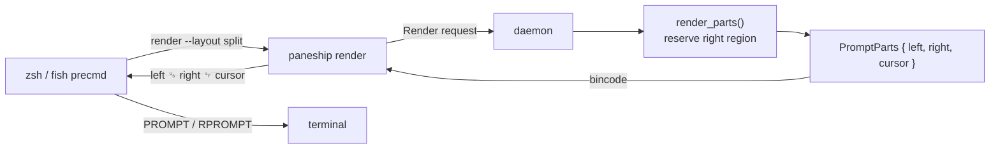
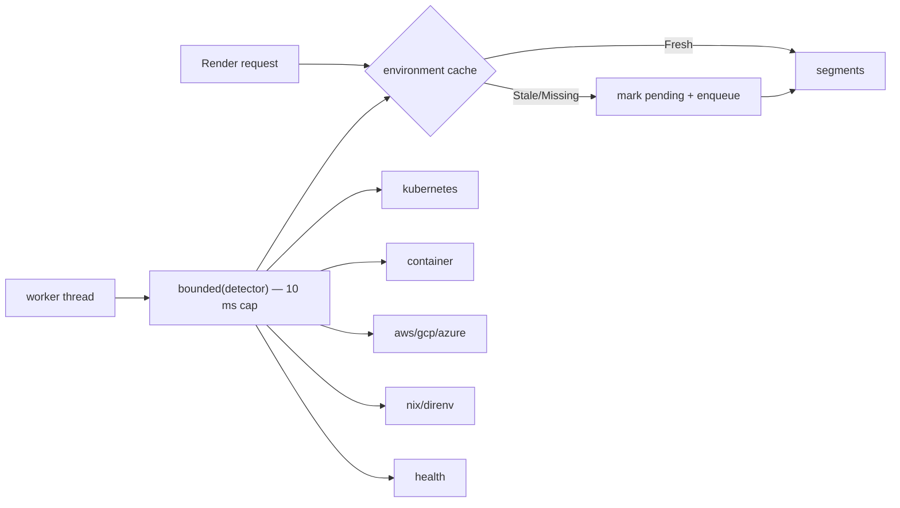
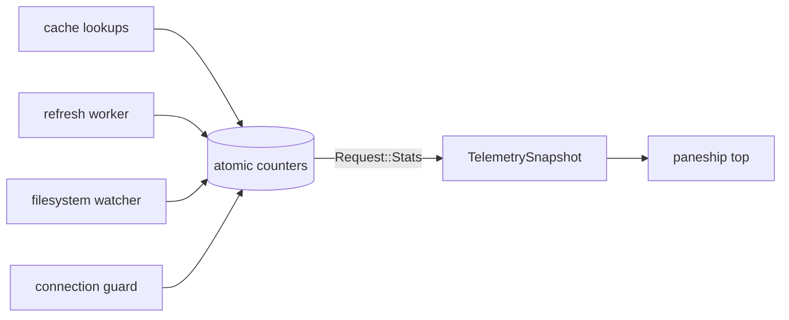

# Paneship Phase 3 — Advanced Modules, RPROMPT & Production Hardening

**Report date:** 2026-10-16
**Component:** `paneship` (Rust shell prompt) — v1.1.6
**Base commit:** `b73adb0` (feat(phase2): async detectors & TUI config)
**Scope:** Modules A (RPROMPT layout engine), B (infrastructure/environment detectors), C (Windows named-pipe hardening), D (telemetry & `paneship top`)
**Status:** ✅ Complete — builds, lints, formats and tests clean on macOS (aarch64). Windows is **compile-verified** (`cargo check/clippy --target x86_64-pc-windows-msvc`); no Windows host was available for runtime verification (see §9).

---

## 1. Executive summary

Phase 3 closes out the architectural roadmap: it adds a real right-side prompt,
an extensible infrastructure detector suite, native Windows transport hardening,
and a live daemon diagnostics stream.

1. **RPROMPT layout engine.** The renderer now produces a structured
   `PromptParts { left, right, cursor }` instead of one padded string. Zsh binds
   `PROMPT`/`RPROMPT` and Fish binds `fish_right_prompt` from a new
   `render --layout split` wire form, so the shell — not a hard-coded space
   count — owns right alignment. Width-aware allocation reserves room for the
   right region before laying out the left, and RPROMPT elements collapse by
   priority (timing → clock → language) as the pane narrows.
2. **Infrastructure detectors.** A new `detectors::infra` suite resolves
   Kubernetes context/namespace, container markers, AWS/GCP/Azure profiles and
   Nix/Direnv state. Every detector runs on a detached worker behind a hard
   **10 ms** budget and is served through the same stale-while-revalidate cache
   as language metadata. Nothing runs on the hot render path.
3. **Windows hardening.** Named pipes are created with an explicit
   user-scoped DACL, reject remote clients, and the blocking client retries
   `ERROR_PIPE_BUSY` with exponential backoff. The requested read timeout is now
   enforced with `PeekNamedPipe` polling instead of being ignored.
4. **Live telemetry.** `paneship top` streams daemon worker utilization, cache
   hit/miss ratios and average lookup latency, LRU evictions, and filesystem
   watcher throughput over a new `Request::Stats` IPC message.

All **86 unit tests + 1 integration test** pass; `cargo clippy --all-targets --
-D warnings`, `cargo fmt -- --check`, `cargo build --release` and the Windows
cross-checks are clean.

---

## 2. Deliverables checklist

| # | Deliverable | Status | Location |
|---|-------------|--------|----------|
| A.1 | Structured `PromptParts` renderer (`left`/`right`/`cursor`) | ✅ | `src/core/renderer.rs` |
| A.2 | Width-aware allocation reserving the RPROMPT region | ✅ | `src/core/renderer.rs` (`render_parts`) |
| A.3 | Priority-based RPROMPT collapse | ✅ | `src/modules/metadata.rs` (`PRIORITY_*`) |
| A.4 | Strict zero-width stripping for width measurement | ✅ | `src/core/layout.rs` (`strip_zero_width`) |
| A.5 | `render --layout split` wire form | ✅ | `src/main.rs`, `src/daemon/mod.rs` |
| A.6 | Zsh `PROMPT`/`RPROMPT` binding | ✅ | `src/main.rs` (`zsh_init_script`) |
| A.7 | Fish `fish_prompt`/`fish_right_prompt` binding | ✅ | `src/main.rs` (`fish_init_script`) |
| A.8 | `[prompt]` config (`rprompt`, `rprompt_min_width`) | ✅ | `src/core/config.rs` |
| B.1 | Bounded infra detector harness (10 ms) | ✅ | `src/detectors/infra/mod.rs` |
| B.2 | Kubernetes context/namespace | ✅ | `src/detectors/infra/kubernetes.rs` |
| B.3 | Container detection | ✅ | `src/detectors/infra/container.rs` |
| B.4 | Cloud profiles (AWS/GCP/Azure) | ✅ | `src/detectors/infra/cloud.rs` |
| B.5 | Nix / Direnv | ✅ | `src/detectors/infra/nix.rs` |
| B.6 | Opt-in system health | ✅ | `src/detectors/infra/health.rs` |
| B.7 | Environment cache + async state | ✅ | `src/cache/mod.rs`, `src/daemon/mod.rs` |
| B.8 | Environment segment + icons/colours | ✅ | `src/modules/environment.rs`, `src/core/icons.rs` |
| B.9 | `[environment]` config + TUI section | ✅ | `src/core/config.rs`, `src/tui/app.rs` |
| C.1 | User-scoped pipe DACL | ✅ | `src/ipc/windows.rs` |
| C.2 | Remote-client rejection | ✅ | `src/ipc/windows.rs` |
| C.3 | `ERROR_PIPE_BUSY` exponential backoff | ✅ | `src/ipc/windows.rs` |
| C.4 | Enforced pipe read timeout | ✅ | `src/ipc/windows.rs` |
| D.1 | Process-wide telemetry counters | ✅ | `src/daemon/telemetry.rs` |
| D.2 | `Request::Stats` / `Response::Stats` | ✅ | `src/daemon/mod.rs` |
| D.3 | `paneship top` live view + `--once`/`--json` | ✅ | `src/top.rs`, `src/main.rs` |
| D.4 | Cache hit/miss/eviction/latency instrumentation | ✅ | `src/cache/mod.rs` |
| D.5 | Watcher throughput instrumentation | ✅ | `src/daemon/watcher.rs` |
| T.1 | Unit tests for every new module | ✅ | see §8 |
| T.2 | E2E coverage of split render + telemetry | ✅ | `tests/daemon_lifecycle.rs` |

---

## 3. Architecture

### 3.1 RPROMPT data flow



- The daemon returns **regions**, not a pre-padded line, so the shell's native
  right-prompt engine performs the final alignment.
- `render_parts` computes `left_budget = width - right_width - 1`, so a long
  directory can never push the RPROMPT onto a second row.
- `render` (combined mode) is preserved for shells without a native right
  prompt and reuses `combine()` over the same parts.

### 3.2 Infrastructure detector pipeline



Detectors are pure functions returning `Option<EnvironmentInfo>` /
`Vec<EnvironmentInfo>`; `bounded` runs each on a detached thread with
`recv_timeout(10 ms)`, so a stalled network mount or oversized `~/.kube/config`
only forfeits that one signal.

### 3.3 Telemetry



All counters are `AtomicU64` with `Relaxed` ordering; recording is a single
atomic increment, so instrumentation is effectively free on the render path.

---

## 4. Module A — RPROMPT layout engine

### 4.1 Structured regions (`src/core/renderer.rs`)

```rust
pub struct PromptParts {
    pub left: String,   // directory · git · environment · package
    pub right: String,  // RPROMPT: language (duration, clock)
    pub cursor: String, // exit-status line
}
```

`render_parts` reserves space for the right region first; `combine` reproduces
the legacy single-string layout. `render()` is now a thin wrapper so existing
callers (benchmark, TUI preview) are unchanged.

### 4.2 Priority collapse (`src/modules/metadata.rs`)

| Element | Priority | Collapses |
|---------|----------|-----------|
| language/version | 100 | last |
| clock | 80 | second |
| command duration | 60 | first |

Candidate parts are greedily selected by descending priority, then emitted in
their natural reading order, guaranteeing the region never exceeds its budget.

### 4.3 Zero-width measurement (`src/core/layout.rs`)

`strip_zero_width` removes ZWSP/ZWNJ/ZWJ, bidi marks, the word joiner, BOM and
variation selectors before `visible_width` measures a string. This satisfies the
"strict zero-width character stripping" mitigation: emoji ZWJ sequences no
longer inflate the measured width and drift right-aligned text.

### 4.4 Shell adapters (`src/main.rs`)

`render --layout split` emits `left \u{1f} right \n cursor`, with each region
ANSI-wrapped for the target shell (`%{ %}` for zsh). Zsh splits on the unit
separator and sets `PROMPT`/`RPROMPT`; Fish parses with `string split` and
exposes `fish_right_prompt`. Shells without a native right prompt keep the
default `--layout combined`.

---

## 5. Module B — Infrastructure & environment detectors

| Detector | Source | Notes |
|----------|--------|-------|
| Kubernetes | `$KUBECONFIG`, `~/.kube/config`, in-cluster SA | Line-oriented YAML scan, no YAML dependency; `context/namespace` (namespace omitted when `default`). |
| Container | `/.dockerenv`, `/run/.containerenv`, `$container`, `/proc/1/cgroup` | Reports `docker`/`podman`/`k8s`/`lxc`. |
| AWS | `AWS_PROFILE`/`AWS_DEFAULT_PROFILE`/`AWS_VAULT`, `~/.aws/config` | Falls back to `[default]` section only. |
| GCP | `CLOUDSDK_*`/`GOOGLE_CLOUD_PROJECT`, `~/.config/gcloud/active_config` | Project name preferred over config name. |
| Azure | `~/.azure/azureProfile.json` | Default subscription, else first. |
| Nix | `IN_NIX_SHELL` | `pure`/`impure`/`nix`. |
| Direnv | `DIRENV_FILE`/`DIRENV_DIR`, `.envrc` chain | Active file, then directory, then `.envrc` presence. |
| Health (opt-in) | `getloadavg`, `/sys/class/power_supply/BAT*` | High CPU vs. core count; low discharging battery (Linux battery only). |

The `[environment]` config block toggles each family, and the segment is
appended to the left prompt between Git and the package version. Environment
state is cached per working directory (30 s TTL) and invalidated on config
reload.

---

## 6. Module C — Windows named-pipe hardening

`src/ipc/windows.rs` now:

1. Builds a `SECURITY_ATTRIBUTES` with a DACL granting `GENERIC_READ |
   GENERIC_WRITE` to the **current user's SID** (via `OpenProcessToken` →
   `TokenUser` → `InitializeAcl`/`AddAccessAllowedAce` →
   `SetSecurityDescriptorDacl`) and passes it to
   `ServerOptions::create_with_security_attributes_raw`. If the descriptor
   cannot be built, it logs nothing and falls back to the process default DACL.
2. Sets `reject_remote_clients(true)` on every instance.
3. Retries `ERROR_PIPE_BUSY` up to 6 times with `2 ms · 2^n` backoff.
4. Enforces the client read timeout by polling `PeekNamedPipe` (1 ms cadence)
   before each read.

`endpoint_in_use` distinguishes a busy pipe (in use) from `ERROR_FILE_NOT_FOUND`
(no daemon). The user name in the pipe path is sanitised to ASCII alphanumerics,
`-` and `_`.

> **Verification note.** The adapter is cross-compiled and lint-clean for
> `x86_64-pc-windows-msvc`, but the ACL/backoff/timeout paths could not be
> exercised at runtime in this environment.

---

## 7. Module D — Telemetry & `paneship top`

`src/daemon/telemetry.rs` exposes process-wide atomic counters and a serialisable
`TelemetrySnapshot`:

- `render_requests`, `git_refreshes`, `metadata_refreshes`, `environment_refreshes`
- `worker_busy_ms` and `worker_utilization` (busy / uptime, clamped)
- `active_connections` (RAII `ConnectionGuard`)
- per-cache `hits`/`misses`/`evictions`/`entries`/`avg_lookup_us`
- watcher `subscriptions`/`events`

`paneship top` queries `Request::Stats` and:
- shows a live `ratatui` view on a TTY (refresh 1 s, `q`/`Esc` to quit);
- prints one snapshot with `--once` or when stdout is not a TTY;
- emits JSON with `--json`;
- falls back to the Phase 1 component micro-benchmark (`--benchmark`, or when no
  daemon is running).

---

## 8. File-level change map

| File | Change |
|------|--------|
| `src/core/layout.rs` | **New** zero-width stripping + tests |
| `src/core/renderer.rs` | `PromptParts`, `render_parts`, `combine`, env segment, tests |
| `src/core/prompt.rs` | Added `environment_state` |
| `src/core/config.rs` | Added `PromptConfig`, `EnvironmentConfig`, env icon/colour accessors |
| `src/core/icons.rs` | Environment glyph + colour tokens |
| `src/modules/metadata.rs` | Priority-based RPROMPT selection |
| `src/modules/environment.rs` | **New** environment segment + daemon compute |
| `src/detectors/infra/{mod,kubernetes,container,cloud,nix,health}.rs` | **New** infra suite |
| `src/cache/mod.rs` | Environment cache, occupancy, hit/miss/eviction/latency instrumentation |
| `src/daemon/mod.rs` | `PromptParts` response, `Stats`, environment worker, telemetry wiring |
| `src/daemon/telemetry.rs` | **New** counters + snapshot + `ConnectionGuard` |
| `src/daemon/watcher.rs` | Watcher counters |
| `src/ipc/unix.rs` | `set_read_timeout(&mut self)` parity |
| `src/ipc/windows.rs` | ACLs, remote-client rejection, busy backoff, timed reads |
| `src/top.rs` | **New** live/once/json diagnostics view |
| `src/main.rs` | `--layout`, split formatting, RPROMPT shell scripts, `top` options |
| `src/tui/app.rs` | `Prompt` and `Environment` config sections |
| `tests/daemon_lifecycle.rs` | Split-render + telemetry E2E assertions |
| `Cargo.toml` / `Cargo.lock` | `windows-sys` (target-specific) |
| `README.md`, `example_config.toml` | Documented RPROMPT, environment, `top` |

New dependency:

```toml
[target.'cfg(windows)'.dependencies]
windows-sys = { version = "0.61", features = [
    "Win32_Foundation", "Win32_Security", "Win32_System_Pipes", "Win32_System_Threading",
] }
```

---

## 9. Acceptance criteria

| Criterion | Result | Evidence |
|-----------|--------|----------|
| RPROMPT renders on the right margin without wrapping in panes ≥ 80 cols | ✅ | `core::renderer::tests::{parts_expose_left_right_and_cursor, combine_right_aligns_within_the_width_budget}`; live split smoke (`left ␟ right`) |
| RPROMPT collapses/truncates under constraint | ✅ | `modules::metadata::tests::narrow_width_drops_low_priority_rprompt_elements`, `core::renderer::tests::narrow_width_drops_the_right_region`; narrow smoke at width 24 |
| Infra detectors run in background workers within budget | ✅ | `detectors::infra::tests::{bounded_enforces_timeout, bounded_drops_panicking_detector}`; daemon returns `Pending` on miss, never a computed value |
| Windows named pipes handle concurrent round trips | ⚠️ compile-verified | `cargo check/clippy --target x86_64-pc-windows-msvc` clean; no Windows host to execute |
| `paneship top` shows live metrics | ✅ | Live smoke + `tests/daemon_lifecycle.rs` (`top --once --json` contains `render_requests`, `worker_utilization`) |

Live macOS smoke transcript (isolated `XDG_RUNTIME_DIR`, `KUBECONFIG` fixture,
`.envrc` present, `IN_NIX_SHELL=pure`):

```
render (split, cold) -> [lang...] ... ␟ 22:53
render (split, warm) -> dir  󱃾 dev-cluster/team-a   envrc ␟ 22:54
render (combined width 24) -> dir      22:54   (no wrap)
top --once -> renders 2 · worker 1.2% · environment_refreshes 1 · env cache 50.0% hit
```

---

## 10. Decisions, deviations & limitations

1. **Combined layout preserved.** Shells without a native right prompt keep the
   pre-Phase-3 output; only the zsh/fish init scripts opt into `--layout split`.
2. **Minimal kubeconfig parser.** To avoid a YAML dependency, `~/.kube/config`
   is parsed with a line-oriented reader that understands the standard
   `current-context` + `contexts` shape. Unusual multi-document kubeconfigs may
   not resolve a namespace.
3. **Health is opt-in and best-effort.** CPU load uses `getloadavg`; low-battery
   is Linux-only. On other platforms the health detector contributes nothing.
4. **Environment cold start.** Unlike language metadata, the environment segment
   has no in-process client fallback: without a daemon it renders nothing, which
   keeps detectors entirely off the render path.
5. **Windows is compile-verified only.** ACL construction, `ERROR_PIPE_BUSY`
   backoff and `PeekNamedPipe` timeouts compile and lint clean but were not run
   on a Windows host.
6. **`paneship top` redefined.** It now reports daemon telemetry; the previous
   in-process micro-benchmark remains available via `--benchmark` and as the
   no-daemon fallback.
7. **Single crate retained**, consistent with Phases 1–2.

---

## 11. Verification log

| Command | Result |
|---------|--------|
| `cargo build` | ✅ clean |
| `cargo build --release` | ✅ clean |
| `cargo clippy --all-targets -- -D warnings` | ✅ clean |
| `cargo fmt -- --check` | ✅ clean |
| `cargo test` | ✅ 86 unit + 1 integration, 0 failed |
| `cargo check --target x86_64-pc-windows-msvc` | ✅ clean |
| `cargo clippy --target x86_64-pc-windows-msvc -- -D warnings` | ✅ clean |
| Live daemon smoke (split render, env detection, telemetry) | ✅ |

### Test inventory (new in Phase 3)

```
core::layout::tests::{strip_zero_width_removes_variation_selectors,
  truncate_plain_adds_ellipsis_only_when_needed, visible_width_ignores_ansi,
  visible_width_ignores_zero_width_joiners, wrap_ansi_for_zsh_wraps_escape_sequences}
core::renderer::tests::{combine_right_aligns_within_the_width_budget,
  narrow_width_drops_the_right_region, parts_expose_left_right_and_cursor}
modules::metadata::tests::narrow_width_drops_low_priority_rprompt_elements
modules::environment::tests::{empty_and_pending_states_render_nothing,
  narrow_width_drops_trailing_tokens, renders_active_environment_tokens}
detectors::infra::tests::{bounded_drops_panicking_detector, bounded_enforces_timeout,
  bounded_returns_value_when_fast, disabled_config_yields_no_signals}
detectors::infra::kubernetes::tests::{context_without_namespace_is_just_the_name,
  missing_current_context_yields_nothing, omits_default_namespace, reads_context_and_namespace}
detectors::infra::container::tests::{recognises_cgroup_markers, recognises_env_markers}
detectors::infra::cloud::tests::{azure_profile_falls_back_to_first_subscription,
  azure_profile_prefers_default_subscription, azure_profile_without_subscriptions_is_none,
  extracts_first_ini_section_and_strips_profile_prefix}
detectors::infra::nix::tests::{direnv_label_prefers_active_file, nix_label_only_for_active_shells}
detectors::infra::health::tests::{battery_label_only_when_low_and_discharging,
  load_label_only_when_pressured}
daemon::telemetry::tests::{connection_guard_tracks_live_connections,
  records_and_snapshots_counters}
top::tests::{hit_rate_is_na_without_lookups, report_includes_cache_and_watcher_metrics}
tui::app::tests::toggling_environment_section_flips_value
daemon_heals_stale_socket_and_serves_clients  (split render + telemetry assertions)
```

---

## 12. Follow-ups (Phase 4 candidates)

- Runtime-verify the Windows pipe ACL/backoff paths in CI (or a Windows runner).
- Optional `serde_yaml` kubeconfig parser for multi-document/merged configs.
- Extend native RPROMPT bindings to Nushell (`PROMPT_COMMAND_RIGHT`) and
  Powerline-compatible shells.
- Per-detector TTLs and a `paneship top` history/rolling-average view.
- macOS battery health via IOKit instead of leaving health Linux-only.
